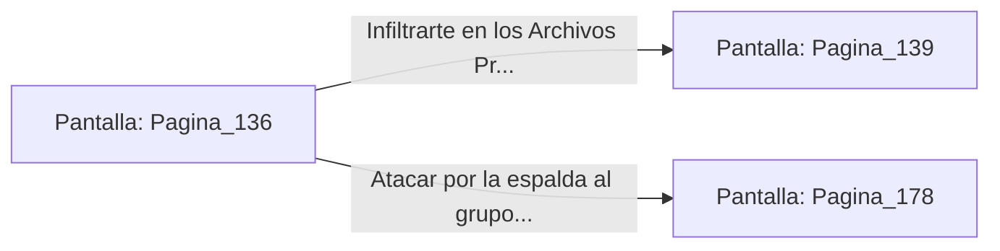

# 📺 Nodo Pantalla: `Pagina_136`

[[Index|⬅️ Índice]] | Fichero Origen: [[sample_eligejuego-code_capitulo_08_mpl|📄 sample/eligejuego-code/capitulo_08.mpl]]

**Narrativa y Encabezado:**
> PÁGINA 136: ALOJAMIENTOS EN LA PENUMBRA
> 
> Avanzas sigilosamente entre las sombras de los pabellones de la Guardia de Élite. Sumidos en la oscuridad generada por el apagón masivo, los soldados se despliegan torpemente buscando linternas de éter secundarias.
> 
> Aprovechas la confusión para colarte por la puerta de servicio que conduce a los Archivos Privados del Palacio.

## 📋 Desglose de Instrucciones de Opciones
### `OPCION "Infiltrarte en los Archivos Privados del Palacio" CON_ACCION TRANSICIONAR_A Pagina_139`
* **Instrucción:** `OPCION` *(Manual: Mapea una entrada o botón interactivo de usuario. Vincular una acción como la invocación de una función C1, un método C2 o una transición C3.)*
* **Efecto de Control:** Dispara `TRANSICIONAR_A` hacia [[Pantalla_Pagina_139|📺 Pagina_139]]
### `OPCION "Atacar por la espalda al grupo de guardias desorientados" CON_ACCION TRANSICIONAR_A Pagina_178`
* **Instrucción:** `OPCION` *(Manual: Mapea una entrada o botón interactivo de usuario. Vincular una acción como la invocación de una función C1, un método C2 o una transición C3.)*
* **Efecto de Control:** Dispara `TRANSICIONAR_A` hacia [[Pantalla_Pagina_178|📺 Pagina_178]]

## 📊 Diagrama de Flujo e Interacción (Mermaid)

