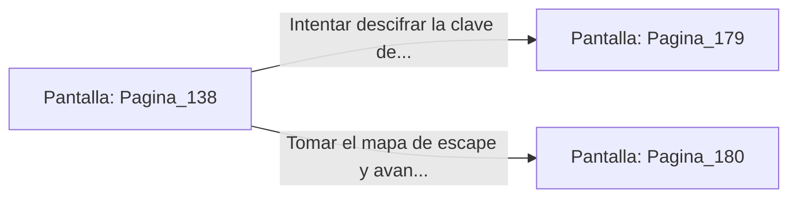

# 📺 Nodo Pantalla: `Pagina_138`

[[Index|⬅️ Índice]] | Fichero Origen: [[sample_eligejuego-code_capitulo_08_mpl|📄 sample/eligejuego-code/capitulo_08.mpl]]

**Narrativa y Encabezado:**
> PÁGINA 138: LOS APOSENTOS REALES
> 
> Entras en los fastuosos Aposentos Reales. Tapices de seda de éter y muebles de madera de rosa decoran la estancia, conservada casi intacta desde antes del alzamiento de Malakor.
> 
> Sobre un escritorio de bronce descubres un cofre tallado que requiere una clave rúnica y un mapa con las rutas secretas de escape del palacio.

## 📋 Desglose de Instrucciones de Opciones
### `OPCION "Intentar descifrar la clave del cofre de bronce" CON_ACCION TRANSICIONAR_A Pagina_179`
* **Instrucción:** `OPCION` *(Manual: Mapea una entrada o botón interactivo de usuario. Vincular una acción como la invocación de una función C1, un método C2 o una transición C3.)*
* **Efecto de Control:** Dispara `TRANSICIONAR_A` hacia [[Pantalla_Pagina_179|📺 Pagina_179]]
### `OPCION "Tomar el mapa de escape y avanzar hacia el Salón de Baile" CON_ACCION TRANSICIONAR_A Pagina_180`
* **Instrucción:** `OPCION` *(Manual: Mapea una entrada o botón interactivo de usuario. Vincular una acción como la invocación de una función C1, un método C2 o una transición C3.)*
* **Efecto de Control:** Dispara `TRANSICIONAR_A` hacia [[Pantalla_Pagina_180|📺 Pagina_180]]

## 📊 Diagrama de Flujo e Interacción (Mermaid)

