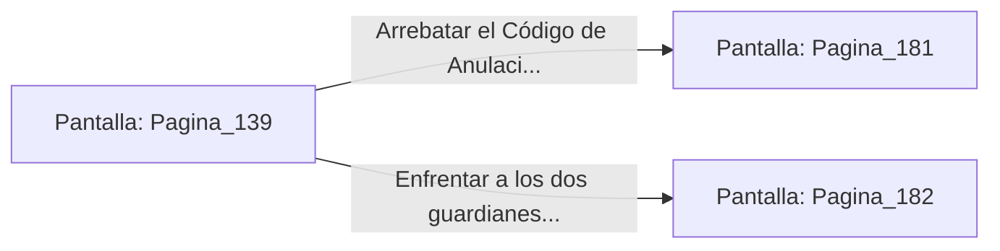

# 📺 Nodo Pantalla: `Pagina_139`

[[Index|⬅️ Índice]] | Fichero Origen: [[sample_eligejuego-code_capitulo_08_mpl|📄 sample/eligejuego-code/capitulo_08.mpl]]

**Narrativa y Encabezado:**
> PÁGINA 139: LOS ARCHIVOS PRIVADOS DEL PALACIO
> 
> Atraviesas las dobles puertas de roble y accedes a los Archivos Privados. Decenas de atriles de piedra sostienen tomos de encuadernación de metal que guardan los decretos secretos de la dinastía de Aethelgard.
> 
> En la sección central, un atril destacado exhibe el Código de Anulación del Segundo Sello de Fase. Al aproximarte, las defensas automáticas de la sala activan dos guardianes de piedra en las esquinas.
> 
> Tienes la opción de arrebatar el documento e iniciar una veloz huida o enfrentar a los dos guardianes de piedra con tu armamento de fase.

## 📋 Desglose de Instrucciones de Opciones
### `OPCION "Arrebatar el Código de Anulación y emprender una veloz huida" CON_ACCION TRANSICIONAR_A Pagina_181`
* **Instrucción:** `OPCION` *(Manual: Mapea una entrada o botón interactivo de usuario. Vincular una acción como la invocación de una función C1, un método C2 o una transición C3.)*
* **Efecto de Control:** Dispara `TRANSICIONAR_A` hacia [[Pantalla_Pagina_181|📺 Pagina_181]]
### `OPCION "Enfrentar a los dos guardianes de piedra de la sala" CON_ACCION TRANSICIONAR_A Pagina_182`
* **Instrucción:** `OPCION` *(Manual: Mapea una entrada o botón interactivo de usuario. Vincular una acción como la invocación de una función C1, un método C2 o una transición C3.)*
* **Efecto de Control:** Dispara `TRANSICIONAR_A` hacia [[Pantalla_Pagina_182|📺 Pagina_182]]

## 📊 Diagrama de Flujo e Interacción (Mermaid)

