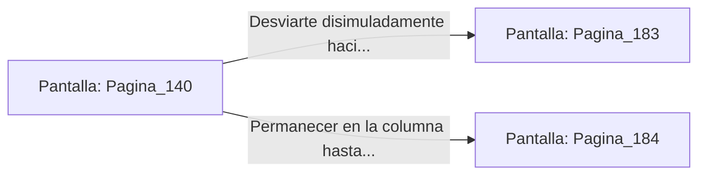

# 📺 Nodo Pantalla: `Pagina_140`

[[Index|⬅️ Índice]] | Fichero Origen: [[sample_eligejuego-code_capitulo_08_mpl|📄 sample/eligejuego-code/capitulo_08.mpl]]

**Narrativa y Encabezado:**
> PÁGINA 140: MARCHANDO CON LA GUARDIA
> 
> Vestido con el jubón militar y manteniendo la cabeza gacha, te incorporas a una columna de guardias que marcha hacia el patio del Bastión Central. Nadie cuestiona tu presencia entre el tumulto.
> 
> Llegas a la puerta de la sala de armas secundaria antes de que la patrulla haga un alto para la revisión de credenciales.

## 📋 Desglose de Instrucciones de Opciones
### `OPCION "Desviarte disimuladamente hacia la sala de armas secundaria" CON_ACCION TRANSICIONAR_A Pagina_183`
* **Instrucción:** `OPCION` *(Manual: Mapea una entrada o botón interactivo de usuario. Vincular una acción como la invocación de una función C1, un método C2 o una transición C3.)*
* **Efecto de Control:** Dispara `TRANSICIONAR_A` hacia [[Pantalla_Pagina_183|📺 Pagina_183]]
### `OPCION "Permanecer en la columna hasta alcanzar la muralla este" CON_ACCION TRANSICIONAR_A Pagina_184`
* **Instrucción:** `OPCION` *(Manual: Mapea una entrada o botón interactivo de usuario. Vincular una acción como la invocación de una función C1, un método C2 o una transición C3.)*
* **Efecto de Control:** Dispara `TRANSICIONAR_A` hacia [[Pantalla_Pagina_184|📺 Pagina_184]]

## 📊 Diagrama de Flujo e Interacción (Mermaid)

