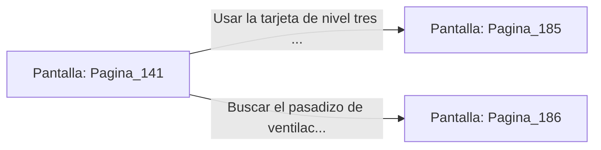

# 📺 Nodo Pantalla: `Pagina_141`

[[Index|⬅️ Índice]] | Fichero Origen: [[sample_eligejuego-code_capitulo_08_mpl|📄 sample/eligejuego-code/capitulo_08.mpl]]

**Narrativa y Encabezado:**
> PÁGINA 141: REGISTRO DE TAQUILLAS EN EL VESTUARIO
> 
> Registras rápidamente las taquillas de la guardia en los vestuarios. Entre pertrechos personales y uniformes, encuentras una tarjeta de nivel tres que otorga acceso a los elevadores del núcleo y una botella de tónico vigorizante.
> 
> Bebes el contenido del tónico, sintiendo cómo una ola de calor reconstituyente recorre tus músculos agotados y sana los contusiones de tus recientes combates.
> 
> Con las fuerzas recuperadas y la tarjeta en tu poder, abandonas los vestuarios rumbo a la plaza de los elevadores.

## 📋 Desglose de Instrucciones de Opciones
### `OPCION "Usar la tarjeta de nivel tres en los elevadores del núcleo" CON_ACCION TRANSICIONAR_A Pagina_185`
* **Instrucción:** `OPCION` *(Manual: Mapea una entrada o botón interactivo de usuario. Vincular una acción como la invocación de una función C1, un método C2 o una transición C3.)*
* **Efecto de Control:** Dispara `TRANSICIONAR_A` hacia [[Pantalla_Pagina_185|📺 Pagina_185]]
### `OPCION "Buscar el pasadizo de ventilación detrás de los vestuarios" CON_ACCION TRANSICIONAR_A Pagina_186`
* **Instrucción:** `OPCION` *(Manual: Mapea una entrada o botón interactivo de usuario. Vincular una acción como la invocación de una función C1, un método C2 o una transición C3.)*
* **Efecto de Control:** Dispara `TRANSICIONAR_A` hacia [[Pantalla_Pagina_186|📺 Pagina_186]]

## 📊 Diagrama de Flujo e Interacción (Mermaid)

