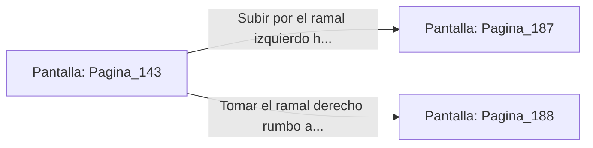

# 📺 Nodo Pantalla: `Pagina_143`

[[Index|⬅️ Índice]] | Fichero Origen: [[sample_eligejuego-code_capitulo_08_mpl|📄 sample/eligejuego-code/capitulo_08.mpl]]

**Narrativa y Encabezado:**
> PÁGINA 143: HUIDA HACIA EL VESTÍBULO
> 
> Sales disparado de la parte trasera de la estatua y atraviesas el Gran Comedor antes de que los guardias puedan reaccionar. Las dobles puertas del fondo se abren a tu paso y te internas en el majestuoso Vestíbulo de las Columnas.
> 
> El vestíbulo está desierto, iluminado solo por la luz de la tormenta que entra a través de las vidrieras superiores. En el centro, una gran escalera de mármol se divide en dos ramales: hacia la Galería de Arte o hacia la Armería Real.
> 
> Debes elegir rápidamente qué ramal tomar antes de que las patrullas del comedor inicien la persecución.

## 📋 Desglose de Instrucciones de Opciones
### `OPCION "Subir por el ramal izquierdo hacia la Galería de Arte" CON_ACCION TRANSICIONAR_A Pagina_187`
* **Instrucción:** `OPCION` *(Manual: Mapea una entrada o botón interactivo de usuario. Vincular una acción como la invocación de una función C1, un método C2 o una transición C3.)*
* **Efecto de Control:** Dispara `TRANSICIONAR_A` hacia [[Pantalla_Pagina_187|📺 Pagina_187]]
### `OPCION "Tomar el ramal derecho rumbo a la Armería Real" CON_ACCION TRANSICIONAR_A Pagina_188`
* **Instrucción:** `OPCION` *(Manual: Mapea una entrada o botón interactivo de usuario. Vincular una acción como la invocación de una función C1, un método C2 o una transición C3.)*
* **Efecto de Control:** Dispara `TRANSICIONAR_A` hacia [[Pantalla_Pagina_188|📺 Pagina_188]]

## 📊 Diagrama de Flujo e Interacción (Mermaid)

