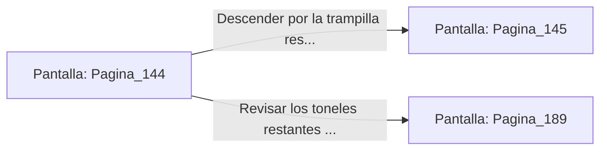

# 📺 Nodo Pantalla: `Pagina_144`

[[Index|⬅️ Índice]] | Fichero Origen: [[sample_eligejuego-code_capitulo_08_mpl|📄 sample/eligejuego-code/capitulo_08.mpl]]

**Narrativa y Encabezado:**
> PÁGINA 144: EL VINO REJUVENECEDOR
> 
> Descorchas el frasco de vino alquímico y bebes su contenido de un solo trago. Una intensa vibración dorada recorre tus venas, sanando instantáneamente todas tus heridas y devolviendo tu vitalidad al máximo.
> 
> Restaurado por completo, abres la trampilla secreta del suelo para continuar la marcha por los túneles de evasión.

## 📋 Desglose de Instrucciones de Opciones
### `OPCION "Descender por la trampilla restaurado hacia los túneles de evasión" CON_ACCION TRANSICIONAR_A Pagina_145`
* **Instrucción:** `OPCION` *(Manual: Mapea una entrada o botón interactivo de usuario. Vincular una acción como la invocación de una función C1, un método C2 o una transición C3.)*
* **Efecto de Control:** Dispara `TRANSICIONAR_A` hacia [[Pantalla_Pagina_145|📺 Pagina_145]]
### `OPCION "Revisar los toneles restantes en busca de más provisiones" CON_ACCION TRANSICIONAR_A Pagina_189`
* **Instrucción:** `OPCION` *(Manual: Mapea una entrada o botón interactivo de usuario. Vincular una acción como la invocación de una función C1, un método C2 o una transición C3.)*
* **Efecto de Control:** Dispara `TRANSICIONAR_A` hacia [[Pantalla_Pagina_189|📺 Pagina_189]]

## 📊 Diagrama de Flujo e Interacción (Mermaid)

