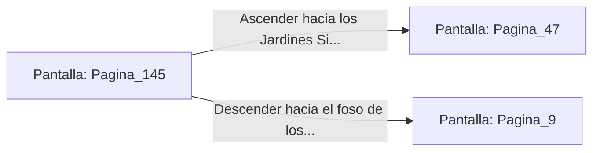

# 📺 Nodo Pantalla: `Pagina_145`

[[Index|⬅️ Índice]] | Fichero Origen: [[sample_eligejuego-code_capitulo_08_mpl|📄 sample/eligejuego-code/capitulo_08.mpl]]

**Narrativa y Encabezado:**
> PÁGINA 145: LOS TÚNELES DE EVASIÓN
> 
> Desciendes por la trampilla hacia un angosto túnel de piedra seca construido por los viejos contrabandistas de Aethelgard. El ambiente es fresco y el aire huele a pino seco y a tierra mojada.
> 
> Avanzas a paso ligero durante varios minutos sin encontrar rastro de vigilancia enemiga. Al final del trayecto, el túnel desemboca en una bifurcación: a la izquierda se sube a los Jardines Sintéticos y a la derecha se baja hacia el foso de los depósitos.
> 
> Esta vía alternativa te permite sorprender a la guardia del sector que elijas.

## 📋 Desglose de Instrucciones de Opciones
### `OPCION "Ascender hacia los Jardines Sintéticos por el acceso secreto" CON_ACCION TRANSICIONAR_A Pagina_47`
* **Instrucción:** `OPCION` *(Manual: Mapea una entrada o botón interactivo de usuario. Vincular una acción como la invocación de una función C1, un método C2 o una transición C3.)*
* **Efecto de Control:** Dispara `TRANSICIONAR_A` hacia [[Pantalla_Pagina_47|📺 Pagina_47]]
### `OPCION "Descender hacia el foso de los depósitos de refrigerante" CON_ACCION TRANSICIONAR_A Pagina_9`
* **Instrucción:** `OPCION` *(Manual: Mapea una entrada o botón interactivo de usuario. Vincular una acción como la invocación de una función C1, un método C2 o una transición C3.)*
* **Efecto de Control:** Dispara `TRANSICIONAR_A` hacia [[Pantalla_Pagina_9|📺 Pagina_9]]

## 📊 Diagrama de Flujo e Interacción (Mermaid)

