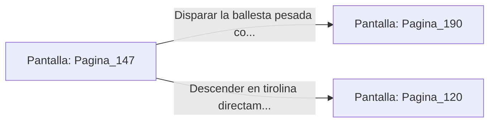

# 📺 Nodo Pantalla: `Pagina_147`

[[Index|⬅️ Índice]] | Fichero Origen: [[sample_eligejuego-code_capitulo_08_mpl|📄 sample/eligejuego-code/capitulo_08.mpl]]

**Narrativa y Encabezado:**
> PÁGINA 147: LA CORNISA DE LOS ARQUEROS
> 
> Te deslizas por la desviación de la escalinata y alcanzas la elevada cornisa de los arqueros que domina toda la Fosa de los Juramentos. Desde esta posición estratégica disfrutas de una vista panorámica privilegiada de la plataforma central.
> 
> Divisas a la perfección la posición del Espectro Temporal y la estructura del Primer Sello de Fase. Además, encuentras una ballesta pesada de energía abandonada sobre un parapeto.
> 
> Puedes usar la ballesta para disparar un proyectil de concusión contra el Espectro o descender en tirolina directamente sobre la plataforma del sello.

## 📋 Desglose de Instrucciones de Opciones
### `OPCION "Disparar la ballesta pesada contra el Espectro Temporal" CON_ACCION TRANSICIONAR_A Pagina_190`
* **Instrucción:** `OPCION` *(Manual: Mapea una entrada o botón interactivo de usuario. Vincular una acción como la invocación de una función C1, un método C2 o una transición C3.)*
* **Efecto de Control:** Dispara `TRANSICIONAR_A` hacia [[Pantalla_Pagina_190|📺 Pagina_190]]
### `OPCION "Descender en tirolina directamente sobre la plataforma del sello" CON_ACCION TRANSICIONAR_A Pagina_120`
* **Instrucción:** `OPCION` *(Manual: Mapea una entrada o botón interactivo de usuario. Vincular una acción como la invocación de una función C1, un método C2 o una transición C3.)*
* **Efecto de Control:** Dispara `TRANSICIONAR_A` hacia [[Pantalla_Pagina_120|📺 Pagina_120]]

## 📊 Diagrama de Flujo e Interacción (Mermaid)

