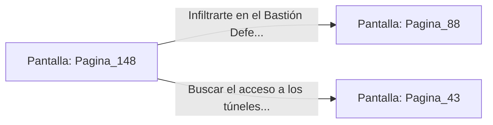

# 📺 Nodo Pantalla: `Pagina_148`

[[Index|⬅️ Índice]] | Fichero Origen: [[sample_eligejuego-code_capitulo_08_mpl|📄 sample/eligejuego-code/capitulo_08.mpl]]

**Narrativa y Encabezado:**
> PÁGINA 148: CRUCE DEL PUENTE A OSCURAS
> 
> Avanzas a paso firme entre las siluetas inmovilizadas de los autómatas desorientados por el apagón. Tu visera táctica compensa la falta de luz, guiándote a través de la calzada del puente sin tropezar.
> 
> Cruzas el portón exterior del puente y alcanzas los bastiones defensivos del recinto interior.

## 📋 Desglose de Instrucciones de Opciones
### `OPCION "Infiltrarte en el Bastión Defensivo Interior" CON_ACCION TRANSICIONAR_A Pagina_88`
* **Instrucción:** `OPCION` *(Manual: Mapea una entrada o botón interactivo de usuario. Vincular una acción como la invocación de una función C1, un método C2 o una transición C3.)*
* **Efecto de Control:** Dispara `TRANSICIONAR_A` hacia [[Pantalla_Pagina_88|📺 Pagina_88]]
### `OPCION "Buscar el acceso a los túneles de drenaje inferiores" CON_ACCION TRANSICIONAR_A Pagina_43`
* **Instrucción:** `OPCION` *(Manual: Mapea una entrada o botón interactivo de usuario. Vincular una acción como la invocación de una función C1, un método C2 o una transición C3.)*
* **Efecto de Control:** Dispara `TRANSICIONAR_A` hacia [[Pantalla_Pagina_43|📺 Pagina_43]]

## 📊 Diagrama de Flujo e Interacción (Mermaid)

