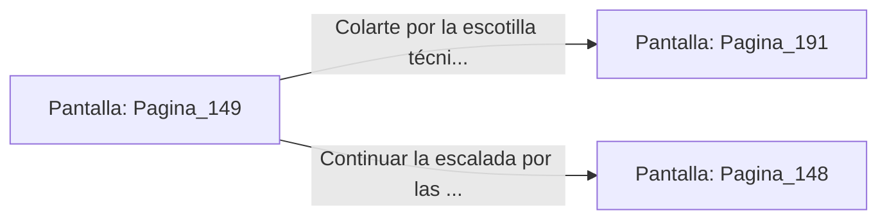

# 📺 Nodo Pantalla: `Pagina_149`

[[Index|⬅️ Índice]] | Fichero Origen: [[sample_eligejuego-code_capitulo_08_mpl|📄 sample/eligejuego-code/capitulo_08.mpl]]

**Narrativa y Encabezado:**
> PÁGINA 149: ESCALADA POR LAS VIGAS INFERIORES
> 
> Te descuelgas por el borde del puente y te agarras a las inmensas vigas estructurales de acero que sostienen la calzada. El viento abisal ruge a tus pies mientras te desplazas mano sobre mano entre los remaches metálicos.
> 
> A mitad de la travesía, descubres una escotilla de inspección técnica que conduce directamente a las salas de bombas del Bastión Central.
> 
> Puedes colarte por la escotilla técnica o continuar escalando por las vigas hasta el otro extremo del puente.

## 📋 Desglose de Instrucciones de Opciones
### `OPCION "Colarte por la escotilla técnica a las salas de bombas" CON_ACCION TRANSICIONAR_A Pagina_191`
* **Instrucción:** `OPCION` *(Manual: Mapea una entrada o botón interactivo de usuario. Vincular una acción como la invocación de una función C1, un método C2 o una transición C3.)*
* **Efecto de Control:** Dispara `TRANSICIONAR_A` hacia [[Pantalla_Pagina_191|📺 Pagina_191]]
### `OPCION "Continuar la escalada por las vigas hasta el final del puente" CON_ACCION TRANSICIONAR_A Pagina_148`
* **Instrucción:** `OPCION` *(Manual: Mapea una entrada o botón interactivo de usuario. Vincular una acción como la invocación de una función C1, un método C2 o una transición C3.)*
* **Efecto de Control:** Dispara `TRANSICIONAR_A` hacia [[Pantalla_Pagina_148|📺 Pagina_148]]

## 📊 Diagrama de Flujo e Interacción (Mermaid)

