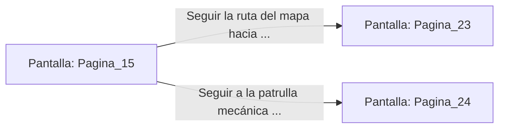

# 📺 Nodo Pantalla: `Pagina_15`

[[Index|⬅️ Índice]] | Fichero Origen: [[sample_eligejuego-code_capitulo_02_mpl|📄 sample/eligejuego-code/capitulo_02.mpl]]

**Narrativa y Encabezado:**
> PÁGINA 15: COBERTURA DE VAPOR
> 
> Te deslizas detrás de un grueso colector de vapor mientras la patrulla mecánica pasa a escasos metros de tu posición. El calor emulado por las tuberías enmascara la firma térmica de tu cuerpo en los sensores del patrullero.
> 
> Una vez que la amenaza se aleja por el corredor oeste, te incorporas y encuentras un mapa de acceso grabado en la placa de la tubería, indicando la ruta directa hacia los Laboratorios de Convergencia.

## 📋 Desglose de Instrucciones de Opciones
### `OPCION "Seguir la ruta del mapa hacia los Laboratorios de Convergencia" CON_ACCION TRANSICIONAR_A Pagina_23`
* **Instrucción:** `OPCION` *(Manual: Mapea una entrada o botón interactivo de usuario. Vincular una acción como la invocación de una función C1, un método C2 o una transición C3.)*
* **Efecto de Control:** Dispara `TRANSICIONAR_A` hacia [[Pantalla_Pagina_23|📺 Pagina_23]]
### `OPCION "Seguir a la patrulla mecánica a distancia para averiguar su destino" CON_ACCION TRANSICIONAR_A Pagina_24`
* **Instrucción:** `OPCION` *(Manual: Mapea una entrada o botón interactivo de usuario. Vincular una acción como la invocación de una función C1, un método C2 o una transición C3.)*
* **Efecto de Control:** Dispara `TRANSICIONAR_A` hacia [[Pantalla_Pagina_24|📺 Pagina_24]]

## 📊 Diagrama de Flujo e Interacción (Mermaid)

