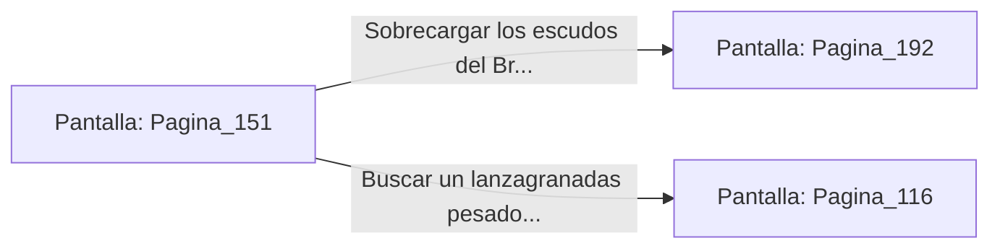

# 📺 Nodo Pantalla: `Pagina_151`

[[Index|⬅️ Índice]] | Fichero Origen: [[sample_eligejuego-code_capitulo_09_mpl|📄 sample/eligejuego-code/capitulo_09.mpl]]

**Narrativa y Encabezado:**
> PÁGINA 151: LA ARMERÍA CENTRAL DEL BASTIÓN
> 
> Subes a paso ligero por la escalinata y te adentras en la vasta nave de la Armería Central. Bastidores de armas arcanas, escudos de fase e hileras de armaduras tácticas se alinean a lo largo de las paredes de granito bajo la atenta mirada de torretas de defensa automatizadas.
> 
> El humo del patio aún no ha llegado hasta aquí, pero las alarmas luminosas parpadean en rojo sobre los marcos de bronce. En el centro de la sala, sobre una peana de obsidiana, descansa una celda de recarga rápida para el Brazal de Convergencia.
> 
> Puedes usar la celda para sobrecargar los escudos de tu equipo o buscar un lanzagranadas pesado antes de que los guardias del sector aseguren los accesos.

## 📋 Desglose de Instrucciones de Opciones
### `OPCION "Sobrecargar los escudos del Brazal en la celda de recarga" CON_ACCION TRANSICIONAR_A Pagina_192`
* **Instrucción:** `OPCION` *(Manual: Mapea una entrada o botón interactivo de usuario. Vincular una acción como la invocación de una función C1, un método C2 o una transición C3.)*
* **Efecto de Control:** Dispara `TRANSICIONAR_A` hacia [[Pantalla_Pagina_192|📺 Pagina_192]]
### `OPCION "Buscar un lanzagranadas pesado en los bastidores blindados" CON_ACCION TRANSICIONAR_A Pagina_116`
* **Instrucción:** `OPCION` *(Manual: Mapea una entrada o botón interactivo de usuario. Vincular una acción como la invocación de una función C1, un método C2 o una transición C3.)*
* **Efecto de Control:** Dispara `TRANSICIONAR_A` hacia [[Pantalla_Pagina_116|📺 Pagina_116]]

## 📊 Diagrama de Flujo e Interacción (Mermaid)

