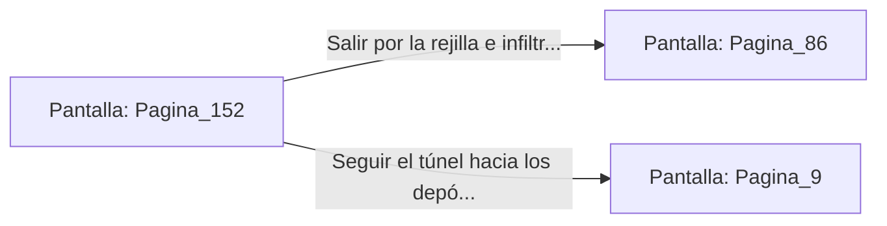

# 📺 Nodo Pantalla: `Pagina_152`

[[Index|⬅️ Índice]] | Fichero Origen: [[sample_eligejuego-code_capitulo_09_mpl|📄 sample/eligejuego-code/capitulo_09.mpl]]

**Narrativa y Encabezado:**
> PÁGINA 152: EL PASAJE DE LOS SIRVIENTES
> 
> Te introduces en el angosto túnel de mantenimiento por el que transitan los autómatas de limpieza. El techo de piedra es bajo y el aire huele a aceite de lubricación y vapor denso.
> 
> Avanzas sigilosamente hasta alcanzar una rejilla de salida que desemboca directamente tras el altar del Templo de la Convergencia.

## 📋 Desglose de Instrucciones de Opciones
### `OPCION "Salir por la rejilla e infiltrarte en el Templo de la Convergencia" CON_ACCION TRANSICIONAR_A Pagina_86`
* **Instrucción:** `OPCION` *(Manual: Mapea una entrada o botón interactivo de usuario. Vincular una acción como la invocación de una función C1, un método C2 o una transición C3.)*
* **Efecto de Control:** Dispara `TRANSICIONAR_A` hacia [[Pantalla_Pagina_86|📺 Pagina_86]]
### `OPCION "Seguir el túnel hacia los depósitos de refrigerante" CON_ACCION TRANSICIONAR_A Pagina_9`
* **Instrucción:** `OPCION` *(Manual: Mapea una entrada o botón interactivo de usuario. Vincular una acción como la invocación de una función C1, un método C2 o una transición C3.)*
* **Efecto de Control:** Dispara `TRANSICIONAR_A` hacia [[Pantalla_Pagina_9|📺 Pagina_9]]

## 📊 Diagrama de Flujo e Interacción (Mermaid)

