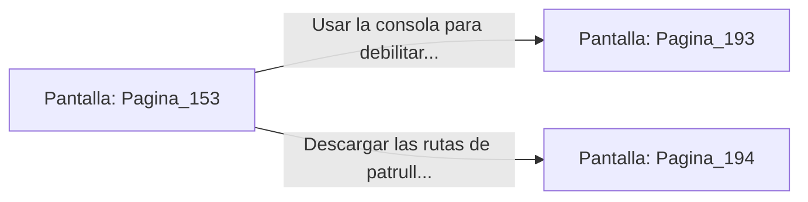

# 📺 Nodo Pantalla: `Pagina_153`

[[Index|⬅️ Índice]] | Fichero Origen: [[sample_eligejuego-code_capitulo_09_mpl|📄 sample/eligejuego-code/capitulo_09.mpl]]

**Narrativa y Encabezado:**
> PÁGINA 153: LA TORRE DE MANDO
> 
> Deslizas la tarjeta de acceso de la Guardia Real por el lector rúnico y las pesadas hojas blindadas de la Torre de Mando se abren sin emitir un solo chirrido. La sala está repleta de pantallas holográficas que muestran el estado operativo de todas las defensas de Aethelgard.
> 
> En el centro del puesto de control, el mapa holográfico del sector confirma que el Segundo Sello de Fase se halla activo en el corazón de los Jardines Sintéticos, protegido por un campo de fuerza de inducción continua.
> 
> Tienes la opción de usar la consola principal para debilitar el campo de fuerza de los Jardines o descargar las rutas de patrulla de la guarnición personal de Malakor.

## 📋 Desglose de Instrucciones de Opciones
### `OPCION "Usar la consola para debilitar el campo de fuerza del Segundo Sello" CON_ACCION TRANSICIONAR_A Pagina_193`
* **Instrucción:** `OPCION` *(Manual: Mapea una entrada o botón interactivo de usuario. Vincular una acción como la invocación de una función C1, un método C2 o una transición C3.)*
* **Efecto de Control:** Dispara `TRANSICIONAR_A` hacia [[Pantalla_Pagina_193|📺 Pagina_193]]
### `OPCION "Descargar las rutas de patrulla de la guarnición de Malakor" CON_ACCION TRANSICIONAR_A Pagina_194`
* **Instrucción:** `OPCION` *(Manual: Mapea una entrada o botón interactivo de usuario. Vincular una acción como la invocación de una función C1, un método C2 o una transición C3.)*
* **Efecto de Control:** Dispara `TRANSICIONAR_A` hacia [[Pantalla_Pagina_194|📺 Pagina_194]]

## 📊 Diagrama de Flujo e Interacción (Mermaid)

