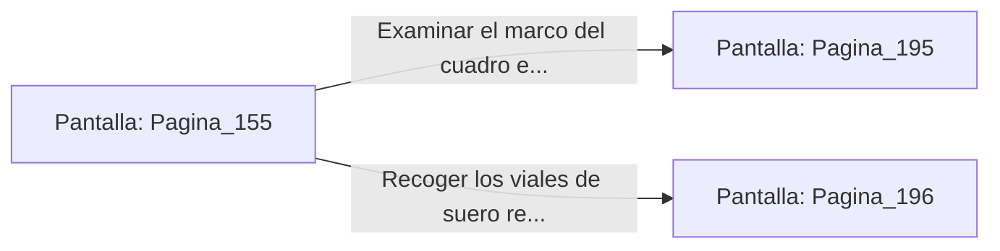

# 📺 Nodo Pantalla: `Pagina_155`

[[Index|⬅️ Índice]] | Fichero Origen: [[sample_eligejuego-code_capitulo_09_mpl|📄 sample/eligejuego-code/capitulo_09.mpl]]

**Narrativa y Encabezado:**
> PÁGINA 155: LOS APOSENTOS DE LOS OFICIALES
> 
> Te descuelgas por la claraboya aterrizando sobre la moqueta de los Aposentos de Oficiales. La estancia está desierta, pero sobre una mesa de caoba descansan planos estratégicos desplegados y varios viales de suero reconstituyente.
> 
> En la pared del fondo, un cuadro de gran tamaño que retrata la caída de la ciudadela parece ocultar un mecanismo hidráulico en su marco de oro.
> 
> Puedes examinar el marco del cuadro en busca de un pasadizo secreto o saquear las mesas tácticas para recoger el suero reconstituyente.

## 📋 Desglose de Instrucciones de Opciones
### `OPCION "Examinar el marco del cuadro en busca de un pasadizo secreto" CON_ACCION TRANSICIONAR_A Pagina_195`
* **Instrucción:** `OPCION` *(Manual: Mapea una entrada o botón interactivo de usuario. Vincular una acción como la invocación de una función C1, un método C2 o una transición C3.)*
* **Efecto de Control:** Dispara `TRANSICIONAR_A` hacia [[Pantalla_Pagina_195|📺 Pagina_195]]
### `OPCION "Recoger los viales de suero reconstituyente de la mesa" CON_ACCION TRANSICIONAR_A Pagina_196`
* **Instrucción:** `OPCION` *(Manual: Mapea una entrada o botón interactivo de usuario. Vincular una acción como la invocación de una función C1, un método C2 o una transición C3.)*
* **Efecto de Control:** Dispara `TRANSICIONAR_A` hacia [[Pantalla_Pagina_196|📺 Pagina_196]]

## 📊 Diagrama de Flujo e Interacción (Mermaid)

