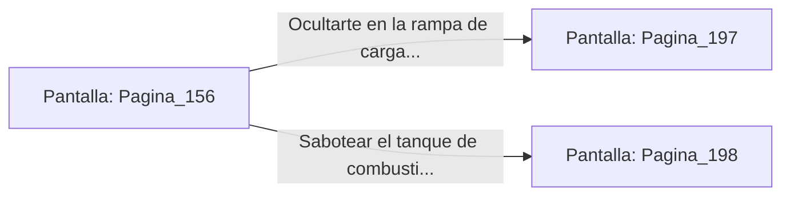

# 📺 Nodo Pantalla: `Pagina_156`

[[Index|⬅️ Índice]] | Fichero Origen: [[sample_eligejuego-code_capitulo_09_mpl|📄 sample/eligejuego-code/capitulo_09.mpl]]

**Narrativa y Encabezado:**
> PÁGINA 156: EL HANGAR TÁCTICO
> 
> Bordeas la cornisa exterior hasta alcanzar el balcón del Hangar Táctico. En el interior, tres lanzaderas de asalto de alas plegables permanecen aparcadas sobre plataformas de elevación magnética.
> 
> Un grupo de mecánicos trabaja en el motor de una de las naves con la rampa de carga abierta.

## 📋 Desglose de Instrucciones de Opciones
### `OPCION "Ocultarte en la rampa de carga de la lanzadera de asalto" CON_ACCION TRANSICIONAR_A Pagina_197`
* **Instrucción:** `OPCION` *(Manual: Mapea una entrada o botón interactivo de usuario. Vincular una acción como la invocación de una función C1, un método C2 o una transición C3.)*
* **Efecto de Control:** Dispara `TRANSICIONAR_A` hacia [[Pantalla_Pagina_197|📺 Pagina_197]]
### `OPCION "Sabotear el tanque de combustible de éter del hangar" CON_ACCION TRANSICIONAR_A Pagina_198`
* **Instrucción:** `OPCION` *(Manual: Mapea una entrada o botón interactivo de usuario. Vincular una acción como la invocación de una función C1, un método C2 o una transición C3.)*
* **Efecto de Control:** Dispara `TRANSICIONAR_A` hacia [[Pantalla_Pagina_198|📺 Pagina_198]]

## 📊 Diagrama de Flujo e Interacción (Mermaid)

