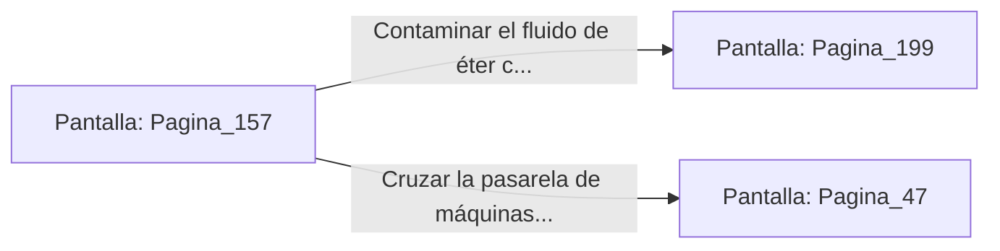

# 📺 Nodo Pantalla: `Pagina_157`

[[Index|⬅️ Índice]] | Fichero Origen: [[sample_eligejuego-code_capitulo_09_mpl|📄 sample/eligejuego-code/capitulo_09.mpl]]

**Narrativa y Encabezado:**
> PÁGINA 157: LA SALA DE MÁQUINAS PRINCIPALES
> 
> Cruzas el portón e ingresas a la monumental Sala de Máquinas Principales. Inmensos pistones hidráulicos se elevan y caen ritmicamente, generando la vibración sorda que retumba en los cimientos de todo el complejo.
> 
> A través de una pasarela suspendida divises la unidad central de bombeo de éter líquido que alimenta los escudos de la Sala del Trono. Un panel de derivación permite alterar la mezcla química de la bomba.
> 
> Tienes la oportunidad de contaminar el fluido de éter con reactivo corrosivo o cruzar la pasarela hacia las galerías de los Jardines.

## 📋 Desglose de Instrucciones de Opciones
### `OPCION "Contaminar el fluido de éter con reactivo corrosivo" CON_ACCION TRANSICIONAR_A Pagina_199`
* **Instrucción:** `OPCION` *(Manual: Mapea una entrada o botón interactivo de usuario. Vincular una acción como la invocación de una función C1, un método C2 o una transición C3.)*
* **Efecto de Control:** Dispara `TRANSICIONAR_A` hacia [[Pantalla_Pagina_199|📺 Pagina_199]]
### `OPCION "Cruzar la pasarela de máquinas rumbo a los Jardines Sintéticos" CON_ACCION TRANSICIONAR_A Pagina_47`
* **Instrucción:** `OPCION` *(Manual: Mapea una entrada o botón interactivo de usuario. Vincular una acción como la invocación de una función C1, un método C2 o una transición C3.)*
* **Efecto de Control:** Dispara `TRANSICIONAR_A` hacia [[Pantalla_Pagina_47|📺 Pagina_47]]

## 📊 Diagrama de Flujo e Interacción (Mermaid)

