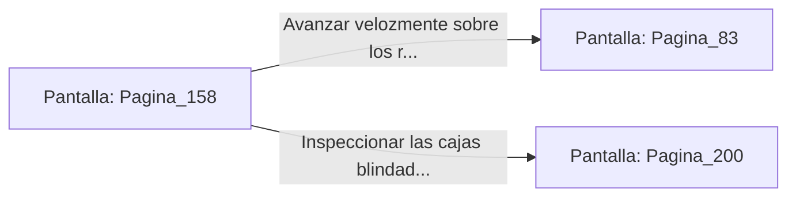

# 📺 Nodo Pantalla: `Pagina_158`

[[Index|⬅️ Índice]] | Fichero Origen: [[sample_eligejuego-code_capitulo_09_mpl|📄 sample/eligejuego-code/capitulo_09.mpl]]

**Narrativa y Encabezado:**
> PÁGINA 158: AVANCE ARMADO POR LAS GALERÍAS
> 
> Avanzas a paso firme por las galerías subterráneas empuñando el lanzagranadas de concusión. Un pelotón de necro-autómatas sale a tu encuentro desde un pasillo lateral.
> 
> Sin vacilar, disparas un proyectil de concusión contra el centro del grupo; la onda expansiva pulveriza los blindajes enemigos y limpia el camino instantáneamente.

## 📋 Desglose de Instrucciones de Opciones
### `OPCION "Avanzar velozmente sobre los restos de los autómatas hacia la Fosa" CON_ACCION TRANSICIONAR_A Pagina_83`
* **Instrucción:** `OPCION` *(Manual: Mapea una entrada o botón interactivo de usuario. Vincular una acción como la invocación de una función C1, un método C2 o una transición C3.)*
* **Efecto de Control:** Dispara `TRANSICIONAR_A` hacia [[Pantalla_Pagina_83|📺 Pagina_83]]
### `OPCION "Inspeccionar las cajas blindadas del pasillo lateral" CON_ACCION TRANSICIONAR_A Pagina_200`
* **Instrucción:** `OPCION` *(Manual: Mapea una entrada o botón interactivo de usuario. Vincular una acción como la invocación de una función C1, un método C2 o una transición C3.)*
* **Efecto de Control:** Dispara `TRANSICIONAR_A` hacia [[Pantalla_Pagina_200|📺 Pagina_200]]

## 📊 Diagrama de Flujo e Interacción (Mermaid)

