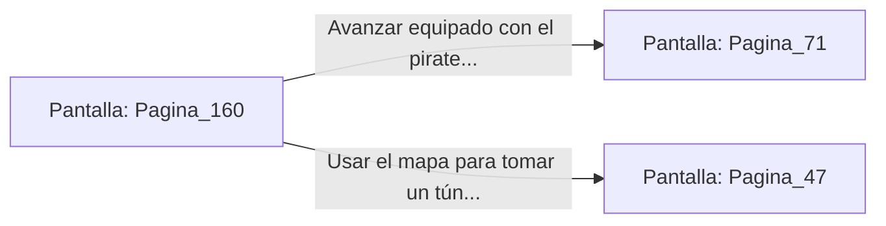

# 📺 Nodo Pantalla: `Pagina_160`

[[Index|⬅️ Índice]] | Fichero Origen: [[sample_eligejuego-code_capitulo_09_mpl|📄 sample/eligejuego-code/capitulo_09.mpl]]

**Narrativa y Encabezado:**
> PÁGINA 160: LOS ARCHIVOS DE MANTENIMIENTO
> 
> Revisas los anaqueles metálicos de los archivos de mantenimiento. Encuentras un plano esquemático de los conductos de aire del Nivel Nueve y un dispositivo de pirateo de frecuencias rúnicas.
> 
> Con estas herramientas guardadas en tu inventario, te sientes capacitado para anular los cierres de emergencia del sector.

## 📋 Desglose de Instrucciones de Opciones
### `OPCION "Avanzar equipado con el pirateador rúnico al Nivel Nueve" CON_ACCION TRANSICIONAR_A Pagina_71`
* **Instrucción:** `OPCION` *(Manual: Mapea una entrada o botón interactivo de usuario. Vincular una acción como la invocación de una función C1, un método C2 o una transición C3.)*
* **Efecto de Control:** Dispara `TRANSICIONAR_A` hacia [[Pantalla_Pagina_71|📺 Pagina_71]]
### `OPCION "Usar el mapa para tomar un túnel de aire hacia los Jardines" CON_ACCION TRANSICIONAR_A Pagina_47`
* **Instrucción:** `OPCION` *(Manual: Mapea una entrada o botón interactivo de usuario. Vincular una acción como la invocación de una función C1, un método C2 o una transición C3.)*
* **Efecto de Control:** Dispara `TRANSICIONAR_A` hacia [[Pantalla_Pagina_47|📺 Pagina_47]]

## 📊 Diagrama de Flujo e Interacción (Mermaid)

