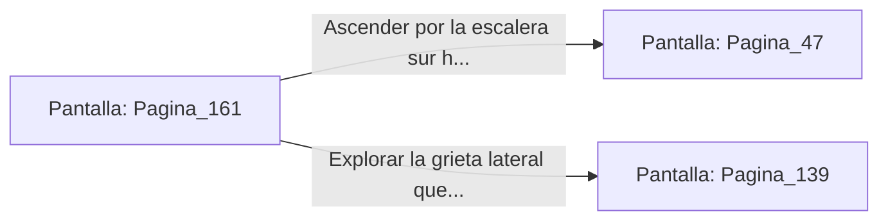

# 📺 Nodo Pantalla: `Pagina_161`

[[Index|⬅️ Índice]] | Fichero Origen: [[sample_eligejuego-code_capitulo_09_mpl|📄 sample/eligejuego-code/capitulo_09.mpl]]

**Narrativa y Encabezado:**
> PÁGINA 161: EL PRIMER SELLO EN TU PODER
> 
> Extiendes la mano y sujetas el Primer Sello de Fase. Una descarga de energía azulina recorre tus brazos mientras la reliquia se sincroniza con el Brazal de Convergencia, fijando el primer vector de desestabilización en la armadura de Malakor.
> 
> Con el sello a buen recaudo, la plataforma central comienza a temblar ligeramente al desactivarse su anclaje místico. Un arco de salida se abre en el muro sur de la fosa, revelando una escalera que asciende a los Jardines Sintéticos.
> 
> Debes decidir si subir hacia los Jardines para buscar el Segundo Sello o explorar la grieta lateral que conduce a los Archivos Privados.

## 📋 Desglose de Instrucciones de Opciones
### `OPCION "Ascender por la escalera sur hacia los Jardines Sintéticos" CON_ACCION TRANSICIONAR_A Pagina_47`
* **Instrucción:** `OPCION` *(Manual: Mapea una entrada o botón interactivo de usuario. Vincular una acción como la invocación de una función C1, un método C2 o una transición C3.)*
* **Efecto de Control:** Dispara `TRANSICIONAR_A` hacia [[Pantalla_Pagina_47|📺 Pagina_47]]
### `OPCION "Explorar la grieta lateral que conduce a los Archivos Privados" CON_ACCION TRANSICIONAR_A Pagina_139`
* **Instrucción:** `OPCION` *(Manual: Mapea una entrada o botón interactivo de usuario. Vincular una acción como la invocación de una función C1, un método C2 o una transición C3.)*
* **Efecto de Control:** Dispara `TRANSICIONAR_A` hacia [[Pantalla_Pagina_139|📺 Pagina_139]]

## 📊 Diagrama de Flujo e Interacción (Mermaid)

