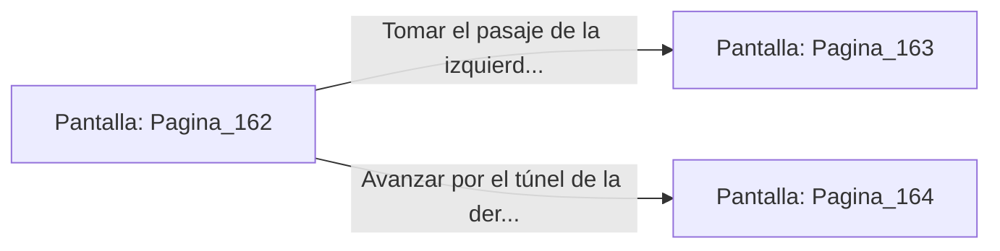

# 📺 Nodo Pantalla: `Pagina_162`

[[Index|⬅️ Índice]] | Fichero Origen: [[sample_eligejuego-code_capitulo_03_laberinto_huesos_mpl|📄 sample/eligejuego-code/capitulo_03_laberinto_huesos.mpl]]

**Narrativa y Encabezado:**
> Página 162: El Laberinto de Huesos
> 
> Cráneos humanos y de bestias forman las paredes de esta galería. Un murmullo bajo resuena en la oscuridad. Te encuentras ante una encrucijada en la penumbra de la mazmorra. Debes tomar una decisión.

## 📋 Desglose de Instrucciones de Opciones
### `OPCION "Tomar el pasaje de la izquierda (Página 163)" CON_ACCION TRANSICIONAR_A Pagina_163`
* **Instrucción:** `OPCION` *(Manual: Mapea una entrada o botón interactivo de usuario. Vincular una acción como la invocación de una función C1, un método C2 o una transición C3.)*
* **Efecto de Control:** Dispara `TRANSICIONAR_A` hacia [[Pantalla_Pagina_163|📺 Pagina_163]]
### `OPCION "Avanzar por el túnel de la derecha (Página 164)" CON_ACCION TRANSICIONAR_A Pagina_164`
* **Instrucción:** `OPCION` *(Manual: Mapea una entrada o botón interactivo de usuario. Vincular una acción como la invocación de una función C1, un método C2 o una transición C3.)*
* **Efecto de Control:** Dispara `TRANSICIONAR_A` hacia [[Pantalla_Pagina_164|📺 Pagina_164]]

## 📊 Diagrama de Flujo e Interacción (Mermaid)

