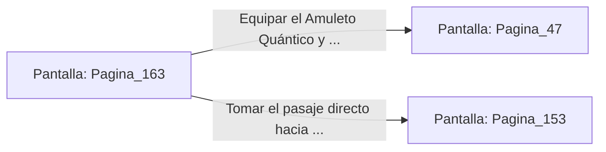

# 📺 Nodo Pantalla: `Pagina_163`

[[Index|⬅️ Índice]] | Fichero Origen: [[sample_eligejuego-code_capitulo_09_mpl|📄 sample/eligejuego-code/capitulo_09.mpl]]

**Narrativa y Encabezado:**
> PÁGINA 163: EL ALTAR DE LA FOSA
> 
> Examinas la superficie de obsidiana del altar donde descansaba el sello. Bajo una capa de polvo rúnico descubres un mecanismo de presión marcado con la insignia de los Antiguos Reyes de Aethelgard.
> 
> Al presionar el grabado, una pequeña losa de la peana se desplaza a un lado, revelando un Amuleto de Protección Quántica y un vial de Éter Puro.
> 
> Guardas ambas reliquias en tu inventario antes de tomar el pasaje que conduce a los niveles superiores.

## 📋 Desglose de Instrucciones de Opciones
### `OPCION "Equipar el Amuleto Quántico y subir hacia los Jardines" CON_ACCION TRANSICIONAR_A Pagina_47`
* **Instrucción:** `OPCION` *(Manual: Mapea una entrada o botón interactivo de usuario. Vincular una acción como la invocación de una función C1, un método C2 o una transición C3.)*
* **Efecto de Control:** Dispara `TRANSICIONAR_A` hacia [[Pantalla_Pagina_47|📺 Pagina_47]]
### `OPCION "Tomar el pasaje directo hacia la Torre de Mando" CON_ACCION TRANSICIONAR_A Pagina_153`
* **Instrucción:** `OPCION` *(Manual: Mapea una entrada o botón interactivo de usuario. Vincular una acción como la invocación de una función C1, un método C2 o una transición C3.)*
* **Efecto de Control:** Dispara `TRANSICIONAR_A` hacia [[Pantalla_Pagina_153|📺 Pagina_153]]

## 📊 Diagrama de Flujo e Interacción (Mermaid)

