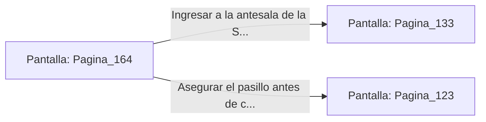

# 📺 Nodo Pantalla: `Pagina_164`

[[Index|⬅️ Índice]] | Fichero Origen: [[sample_eligejuego-code_capitulo_09_mpl|📄 sample/eligejuego-code/capitulo_09.mpl]]

**Narrativa y Encabezado:**
> PÁGINA 164: LA PUERTA DE LOS CIEN CERROJOS
> 
> Conectas tu interfaz rúnica al panel de la Puerta de los Cien Cerrojos. La pantalla parpadea frenéticamente mientras el Brazal de Convergencia procesa las secuencias de desactivación una a una.
> 
> Tras unos segundos de agónica espera, los cerrojos de bronce se retrayen en el marco con una serie de chasquidos pesados, abriendo paso a la antesala del trono.

## 📋 Desglose de Instrucciones de Opciones
### `OPCION "Ingresar a la antesala de la Sala del Trono" CON_ACCION TRANSICIONAR_A Pagina_133`
* **Instrucción:** `OPCION` *(Manual: Mapea una entrada o botón interactivo de usuario. Vincular una acción como la invocación de una función C1, un método C2 o una transición C3.)*
* **Efecto de Control:** Dispara `TRANSICIONAR_A` hacia [[Pantalla_Pagina_133|📺 Pagina_133]]
### `OPCION "Asegurar el pasillo antes de cruzar la puerta" CON_ACCION TRANSICIONAR_A Pagina_123`
* **Instrucción:** `OPCION` *(Manual: Mapea una entrada o botón interactivo de usuario. Vincular una acción como la invocación de una función C1, un método C2 o una transición C3.)*
* **Efecto de Control:** Dispara `TRANSICIONAR_A` hacia [[Pantalla_Pagina_123|📺 Pagina_123]]

## 📊 Diagrama de Flujo e Interacción (Mermaid)

