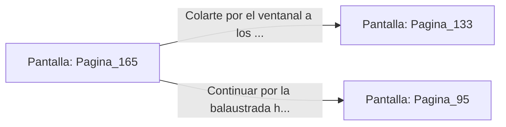

# 📺 Nodo Pantalla: `Pagina_165`

[[Index|⬅️ Índice]] | Fichero Origen: [[sample_eligejuego-code_capitulo_09_mpl|📄 sample/eligejuego-code/capitulo_09.mpl]]

**Narrativa y Encabezado:**
> PÁGINA 165: LAS BALCONADAS EXTERIORES
> 
> Te desvías de la puerta principal y salitas a las balconadas de mármol que bordean el abismo exterior del palacio. La tormenta de éter ruge a pocos metros, azotando los ventanales con ráfagas de lluvia cristalina.
> 
> Avanzas pegado a la balaustrada hasta encontrar un ventanal entornado que da acceso a la galería superior de los balcones de la Sala del Trono.
> 
> Puedes colarte por el ventanal para ganar una posición de tiro elevada o seguir la balaustrada hacia los tejados superiores.

## 📋 Desglose de Instrucciones de Opciones
### `OPCION "Colarte por el ventanal a los balcones superiores de la Sala del Trono" CON_ACCION TRANSICIONAR_A Pagina_133`
* **Instrucción:** `OPCION` *(Manual: Mapea una entrada o botón interactivo de usuario. Vincular una acción como la invocación de una función C1, un método C2 o una transición C3.)*
* **Efecto de Control:** Dispara `TRANSICIONAR_A` hacia [[Pantalla_Pagina_133|📺 Pagina_133]]
### `OPCION "Continuar por la balaustrada hacia los Tejados del Palacio" CON_ACCION TRANSICIONAR_A Pagina_95`
* **Instrucción:** `OPCION` *(Manual: Mapea una entrada o botón interactivo de usuario. Vincular una acción como la invocación de una función C1, un método C2 o una transición C3.)*
* **Efecto de Control:** Dispara `TRANSICIONAR_A` hacia [[Pantalla_Pagina_95|📺 Pagina_95]]

## 📊 Diagrama de Flujo e Interacción (Mermaid)

