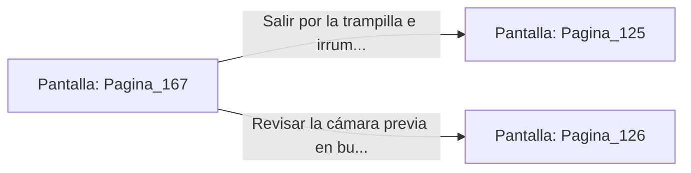

# 📺 Nodo Pantalla: `Pagina_167`

[[Index|⬅️ Índice]] | Fichero Origen: [[sample_eligejuego-code_capitulo_09_mpl|📄 sample/eligejuego-code/capitulo_09.mpl]]

**Narrativa y Encabezado:**
> PÁGINA 167: EL PASAJE DE LA CRIPTA AL BASTIÓN
> 
> Avanzas entre los sarcófagos hasta encontrar un arco de piedra sin decorar que da acceso a un túnel de ascenso. La mampostería antigua da paso gradualmente al sillar de granito propio de las fortificaciones del Bastión.
> 
> Al final del pasaje, una trampilla de hierro te permite salir directamente tras la barricada defensiva del patio interno del Bastión de Guerra.
> 
> Puedes salir por la trampilla para sorprender a los defensores por la espalda o revisar la cámara previa en busca de armamento de repuesto.

## 📋 Desglose de Instrucciones de Opciones
### `OPCION "Salir por la trampilla e irrumpir tras la barricada del Bastión" CON_ACCION TRANSICIONAR_A Pagina_125`
* **Instrucción:** `OPCION` *(Manual: Mapea una entrada o botón interactivo de usuario. Vincular una acción como la invocación de una función C1, un método C2 o una transición C3.)*
* **Efecto de Control:** Dispara `TRANSICIONAR_A` hacia [[Pantalla_Pagina_125|📺 Pagina_125]]
### `OPCION "Revisar la cámara previa en busca de armamento" CON_ACCION TRANSICIONAR_A Pagina_126`
* **Instrucción:** `OPCION` *(Manual: Mapea una entrada o botón interactivo de usuario. Vincular una acción como la invocación de una función C1, un método C2 o una transición C3.)*
* **Efecto de Control:** Dispara `TRANSICIONAR_A` hacia [[Pantalla_Pagina_126|📺 Pagina_126]]

## 📊 Diagrama de Flujo e Interacción (Mermaid)

