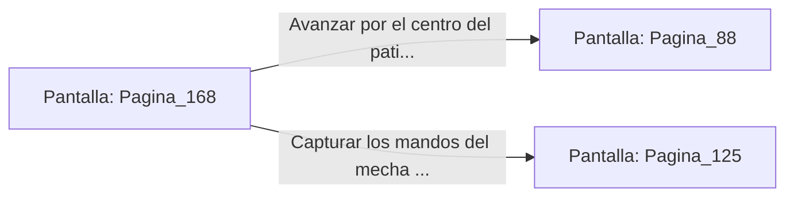

# 📺 Nodo Pantalla: `Pagina_168`

[[Index|⬅️ Índice]] | Fichero Origen: [[sample_eligejuego-code_capitulo_09_mpl|📄 sample/eligejuego-code/capitulo_09.mpl]]

**Narrativa y Encabezado:**
> PÁGINA 168: ATAQUE A LAS ARTICULACIONES DEL MECHA
> 
> Te esquivas bajo la ráfaga de fuego del mecha blindado y lanzas una estocada precisa con el estoque de luz contra el servo de la rodilla derecha. La hoja de fase atraviesa la aleación, provocando un chispazo que inmoviliza la extremidad.
> 
> El vehículo inclina torpemente y el piloto se ve obligado a eyectarse, dejando despejado el centro del patio.

## 📋 Desglose de Instrucciones de Opciones
### `OPCION "Avanzar por el centro del patio hacia el Gran Portal" CON_ACCION TRANSICIONAR_A Pagina_88`
* **Instrucción:** `OPCION` *(Manual: Mapea una entrada o botón interactivo de usuario. Vincular una acción como la invocación de una función C1, un método C2 o una transición C3.)*
* **Efecto de Control:** Dispara `TRANSICIONAR_A` hacia [[Pantalla_Pagina_88|📺 Pagina_88]]
### `OPCION "Capturar los mandos del mecha dañado" CON_ACCION TRANSICIONAR_A Pagina_125`
* **Instrucción:** `OPCION` *(Manual: Mapea una entrada o botón interactivo de usuario. Vincular una acción como la invocación de una función C1, un método C2 o una transición C3.)*
* **Efecto de Control:** Dispara `TRANSICIONAR_A` hacia [[Pantalla_Pagina_125|📺 Pagina_125]]

## 📊 Diagrama de Flujo e Interacción (Mermaid)

