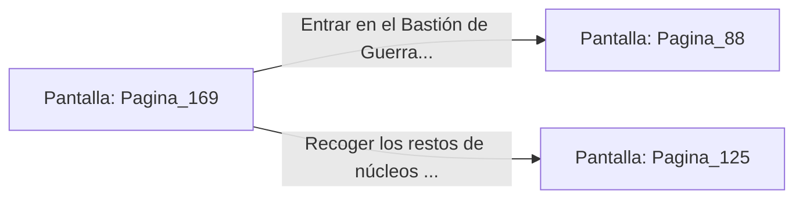

# 📺 Nodo Pantalla: `Pagina_169`

[[Index|⬅️ Índice]] | Fichero Origen: [[sample_eligejuego-code_capitulo_09_mpl|📄 sample/eligejuego-code/capitulo_09.mpl]]

**Narrativa y Encabezado:**
> PÁGINA 169: REFLEJO CON EL ESCUDO CUÁNTICO
> 
> Plantas firme tus botas sobre las losas del patio y despliegas el escudo cuántico justo cuando el mecha dispara su cañón principal de plasma. El campo de fuerza absorbe el impacto e invierte el vector de la descarga.
> 
> El haz de plasma reflejado impacta directamente contra el núcleo energizado del mecha, provocando una explosión limpia que destruye la máquina sin dañar la estructura del patio.
> 
> Con la amenaza neutralizada, los guardias supervivientes huyen y la entrada a la fortaleza queda libre a tu paso.

## 📋 Desglose de Instrucciones de Opciones
### `OPCION "Entrar en el Bastión de Guerra por el portón principal" CON_ACCION TRANSICIONAR_A Pagina_88`
* **Instrucción:** `OPCION` *(Manual: Mapea una entrada o botón interactivo de usuario. Vincular una acción como la invocación de una función C1, un método C2 o una transición C3.)*
* **Efecto de Control:** Dispara `TRANSICIONAR_A` hacia [[Pantalla_Pagina_88|📺 Pagina_88]]
### `OPCION "Recoger los restos de núcleos energéticos de la explosión" CON_ACCION TRANSICIONAR_A Pagina_125`
* **Instrucción:** `OPCION` *(Manual: Mapea una entrada o botón interactivo de usuario. Vincular una acción como la invocación de una función C1, un método C2 o una transición C3.)*
* **Efecto de Control:** Dispara `TRANSICIONAR_A` hacia [[Pantalla_Pagina_125|📺 Pagina_125]]

## 📊 Diagrama de Flujo e Interacción (Mermaid)

