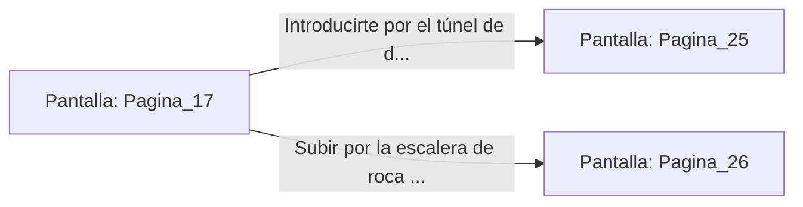

# 📺 Nodo Pantalla: `Pagina_17`

[[Index|⬅️ Índice]] | Fichero Origen: [[sample_eligejuego-code_capitulo_02_mpl|📄 sample/eligejuego-code/capitulo_02.mpl]]

**Narrativa y Encabezado:**
> PÁGINA 17: EL TESORO DEL ESTANQUE
> 
> Te sumerges en las aguas heladas, sintiendo cómo el frío entumece tus extremidades en segundos. Nadas con esfuerzo hasta el fondo y logras accionar el cierre magnético del arcón, el cual se abre liberando una burbuja de aire comprimido y un vial de Éter Puro.
> 
> Al tomar el vial y adosarlo a tu Brazal de Convergencia, una corriente de energía vigorizante recorre tu sistema nervioso, curando tus heridas y restaurando tu resistencia por completo. Has obtenido una mejora crítica de estado.
> 
> Sales a la superficie tiritando pero fortalecido. A la orilla del estanque descubres dos salidas: un túnel de drenaje hacia el foso de residuos y una escalera tallada en la roca viva.

## 📋 Desglose de Instrucciones de Opciones
### `OPCION "Introducirte por el túnel de drenaje hacia el Foso de Residuos" CON_ACCION TRANSICIONAR_A Pagina_25`
* **Instrucción:** `OPCION` *(Manual: Mapea una entrada o botón interactivo de usuario. Vincular una acción como la invocación de una función C1, un método C2 o una transición C3.)*
* **Efecto de Control:** Dispara `TRANSICIONAR_A` hacia [[Pantalla_Pagina_25|📺 Pagina_25]]
### `OPCION "Subir por la escalera de roca viva hacia los niveles superiores" CON_ACCION TRANSICIONAR_A Pagina_26`
* **Instrucción:** `OPCION` *(Manual: Mapea una entrada o botón interactivo de usuario. Vincular una acción como la invocación de una función C1, un método C2 o una transición C3.)*
* **Efecto de Control:** Dispara `TRANSICIONAR_A` hacia [[Pantalla_Pagina_26|📺 Pagina_26]]

## 📊 Diagrama de Flujo e Interacción (Mermaid)

