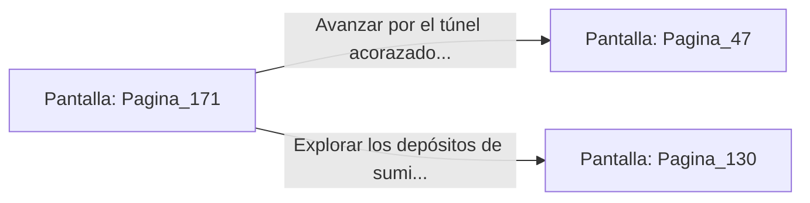

# 📺 Nodo Pantalla: `Pagina_171`

[[Index|⬅️ Índice]] | Fichero Origen: [[sample_eligejuego-code_capitulo_10_mpl|📄 sample/eligejuego-code/capitulo_10.mpl]]

**Narrativa y Encabezado:**
> PÁGINA 171: SABOTAJE EN LA CINTA TRANSPORTADORA
> 
> Introduces un bloque metálico entre los engranajes primarios de la cinta transportadora del taller. Las cadenas de tracción rechinan con furia antes de romper los cierres hidráulicos, provocando una colisión en cadena que destruye tres autómatas pesados en fase de ensamblaje.
> 
> El estruendo de la explosión metálica y las alarmas de avería obligan a los técnicos y guardias del taller a evacuar la nave presurosamente. La vía principal de la fábrica queda completamente despejada de vigilancia.
> 
> Aprovechas el caos para cruzar la nave de montaje y dirigirte hacia el túnel acorazado que conduce a los Jardines Sintéticos o hacia los depósitos de suministro.

## 📋 Desglose de Instrucciones de Opciones
### `OPCION "Avanzar por el túnel acorazado hacia los Jardines Sintéticos" CON_ACCION TRANSICIONAR_A Pagina_47`
* **Instrucción:** `OPCION` *(Manual: Mapea una entrada o botón interactivo de usuario. Vincular una acción como la invocación de una función C1, un método C2 o una transición C3.)*
* **Efecto de Control:** Dispara `TRANSICIONAR_A` hacia [[Pantalla_Pagina_47|📺 Pagina_47]]
### `OPCION "Explorar los depósitos de suministro abandonados" CON_ACCION TRANSICIONAR_A Pagina_130`
* **Instrucción:** `OPCION` *(Manual: Mapea una entrada o botón interactivo de usuario. Vincular una acción como la invocación de una función C1, un método C2 o una transición C3.)*
* **Efecto de Control:** Dispara `TRANSICIONAR_A` hacia [[Pantalla_Pagina_130|📺 Pagina_130]]

## 📊 Diagrama de Flujo e Interacción (Mermaid)

