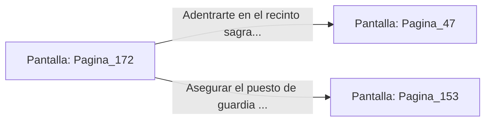

# 📺 Nodo Pantalla: `Pagina_172`

[[Index|⬅️ Índice]] | Fichero Origen: [[sample_eligejuego-code_capitulo_10_mpl|📄 sample/eligejuego-code/capitulo_10.mpl]]

**Narrativa y Encabezado:**
> PÁGINA 172: ATAQUE AL FLANCO ESTE DESABASTECIDO
> 
> Avanzas sigilosamente por los conductos superiores hasta alcanzar el puesto de guardia del flanco este. Confirmando la información interceptada, los soldados de Malakor patrullan con linternas de mano defectuosas y sus escudos de fase permanecen desactivados para ahorrar energía.
> 
> Sin encontrar apenas resistencia, neutralizas al centinela de la puerta y te adentras en el recinto sagrado de los Jardines Sintéticos.

## 📋 Desglose de Instrucciones de Opciones
### `OPCION "Adentrarte en el recinto sagrado de los Jardines Sintéticos" CON_ACCION TRANSICIONAR_A Pagina_47`
* **Instrucción:** `OPCION` *(Manual: Mapea una entrada o botón interactivo de usuario. Vincular una acción como la invocación de una función C1, un método C2 o una transición C3.)*
* **Efecto de Control:** Dispara `TRANSICIONAR_A` hacia [[Pantalla_Pagina_47|📺 Pagina_47]]
### `OPCION "Asegurar el puesto de guardia del flanco este antes de continuar" CON_ACCION TRANSICIONAR_A Pagina_153`
* **Instrucción:** `OPCION` *(Manual: Mapea una entrada o botón interactivo de usuario. Vincular una acción como la invocación de una función C1, un método C2 o una transición C3.)*
* **Efecto de Control:** Dispara `TRANSICIONAR_A` hacia [[Pantalla_Pagina_153|📺 Pagina_153]]

## 📊 Diagrama de Flujo e Interacción (Mermaid)

