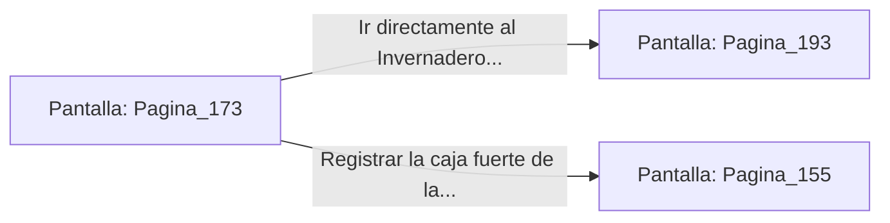

# 📺 Nodo Pantalla: `Pagina_173`

[[Index|⬅️ Índice]] | Fichero Origen: [[sample_eligejuego-code_capitulo_10_mpl|📄 sample/eligejuego-code/capitulo_10.mpl]]

**Narrativa y Encabezado:**
> PÁGINA 173: INTERROGATORIO AL COMANDANTE
> 
> Te dejas caer de la rejilla de ventilación e inmovilizas al comandante sobre la mesa táctica antes de que pueda accionar la alarma. Su acompañante intenta desenvainar su arma, pero lo dejas inconsciente de un certero golpe de empuñadura.
> 
> Con la hoja oculta de tu Brazal apuntando a su cuello, el comandante confiesa asustado la frecuencia exacta que desactiva los reflectores y las torretas del Segundo Sello de Fase, situado en el Invernadero Central.
> 
> Con la contraseña de anulación grabada en tu memoria, inutilizas al oficial y abandonas la sala por la puerta de servicio.

## 📋 Desglose de Instrucciones de Opciones
### `OPCION "Ir directamente al Invernadero Central para desactivar el Segundo Sello" CON_ACCION TRANSICIONAR_A Pagina_193`
* **Instrucción:** `OPCION` *(Manual: Mapea una entrada o botón interactivo de usuario. Vincular una acción como la invocación de una función C1, un método C2 o una transición C3.)*
* **Efecto de Control:** Dispara `TRANSICIONAR_A` hacia [[Pantalla_Pagina_193|📺 Pagina_193]]
### `OPCION "Registrar la caja fuerte de la sala táctica en busca de mapas" CON_ACCION TRANSICIONAR_A Pagina_155`
* **Instrucción:** `OPCION` *(Manual: Mapea una entrada o botón interactivo de usuario. Vincular una acción como la invocación de una función C1, un método C2 o una transición C3.)*
* **Efecto de Control:** Dispara `TRANSICIONAR_A` hacia [[Pantalla_Pagina_155|📺 Pagina_155]]

## 📊 Diagrama de Flujo e Interacción (Mermaid)

