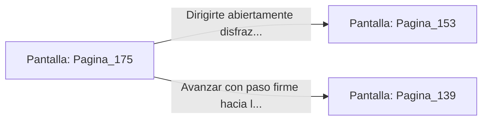

# 📺 Nodo Pantalla: `Pagina_175`

[[Index|⬅️ Índice]] | Fichero Origen: [[sample_eligejuego-code_capitulo_10_mpl|📄 sample/eligejuego-code/capitulo_10.mpl]]

**Narrativa y Encabezado:**
> PÁGINA 175: DISFRAZ DE OFICIAL
> 
> Te despojas de la túnica del oficial inconsciente y te la calzas sobre tu armadura ligera. El uniforme de comandante luciendo las insignias de Malakor te otorga un camuflaje perfecto para moverte por las instalaciones de alto nivel.
> 
> Ajustas la gorra militar sobre tus ojos y abandonas la estancia cruzando el pasillo principal. Las patrullas de autómatas que te cruzas en el camino se cuadran a tu paso sin solicitar identificaciones de credencial.
> 
> Gracias a tu disfraz, te planteas dirigirte abiertamente hacia la Torre de Mando o hacia los Archivos Privados del Palacio.

## 📋 Desglose de Instrucciones de Opciones
### `OPCION "Dirigirte abiertamente disfrazado hacia la Torre de Mando" CON_ACCION TRANSICIONAR_A Pagina_153`
* **Instrucción:** `OPCION` *(Manual: Mapea una entrada o botón interactivo de usuario. Vincular una acción como la invocación de una función C1, un método C2 o una transición C3.)*
* **Efecto de Control:** Dispara `TRANSICIONAR_A` hacia [[Pantalla_Pagina_153|📺 Pagina_153]]
### `OPCION "Avanzar con paso firme hacia los Archivos Privados del Palacio" CON_ACCION TRANSICIONAR_A Pagina_139`
* **Instrucción:** `OPCION` *(Manual: Mapea una entrada o botón interactivo de usuario. Vincular una acción como la invocación de una función C1, un método C2 o una transición C3.)*
* **Efecto de Control:** Dispara `TRANSICIONAR_A` hacia [[Pantalla_Pagina_139|📺 Pagina_139]]

## 📊 Diagrama de Flujo e Interacción (Mermaid)

