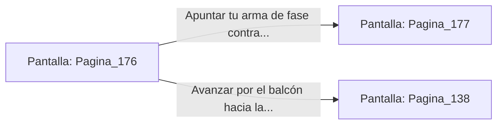

# 📺 Nodo Pantalla: `Pagina_176`

[[Index|⬅️ Índice]] | Fichero Origen: [[sample_eligejuego-code_capitulo_10_mpl|📄 sample/eligejuego-code/capitulo_10.mpl]]

**Narrativa y Encabezado:**
> PÁGINA 176: INFILTRACIÓN EN LOS BALCONES
> 
> Te descuelgas en silencio por el tragaluz lateral y te posas en la moqueta del balcón superior de la Sala del Trono. La posición te ofrece una cobertura inmejorable oculto tras los gruesos cortinajes de seda carmesí.
> 
> Desde esta altura observas el arca de energía que alimenta el trono de Malakor y la ubicación de los centinelas de la Guardia Personal.

## 📋 Desglose de Instrucciones de Opciones
### `OPCION "Apuntar tu arma de fase contra el arca de energía del trono" CON_ACCION TRANSICIONAR_A Pagina_177`
* **Instrucción:** `OPCION` *(Manual: Mapea una entrada o botón interactivo de usuario. Vincular una acción como la invocación de una función C1, un método C2 o una transición C3.)*
* **Efecto de Control:** Dispara `TRANSICIONAR_A` hacia [[Pantalla_Pagina_177|📺 Pagina_177]]
### `OPCION "Avanzar por el balcón hacia la antesala privada de Malakor" CON_ACCION TRANSICIONAR_A Pagina_138`
* **Instrucción:** `OPCION` *(Manual: Mapea una entrada o botón interactivo de usuario. Vincular una acción como la invocación de una función C1, un método C2 o una transición C3.)*
* **Efecto de Control:** Dispara `TRANSICIONAR_A` hacia [[Pantalla_Pagina_138|📺 Pagina_138]]

## 📊 Diagrama de Flujo e Interacción (Mermaid)

