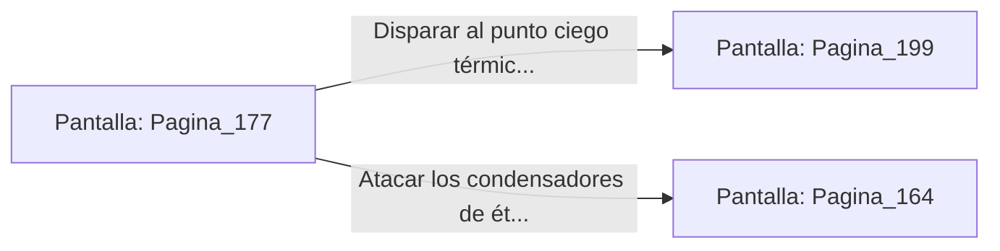

# 📺 Nodo Pantalla: `Pagina_177`

[[Index|⬅️ Índice]] | Fichero Origen: [[sample_eligejuego-code_capitulo_10_mpl|📄 sample/eligejuego-code/capitulo_10.mpl]]

**Narrativa y Encabezado:**
> PÁGINA 177: ATAQUE A LA CÚPULA DEL TRONO
> 
> Detonas la carga colocada en el vitral y te lanzas al interior de la Sala del Trono envuelto en una lluvia de cristales entintados. El estruendo de la explosión pilla por sorpresa a los guardias de Malakor, que se cubren del impacto de los fragmentos.
> 
> Aterrizas sobre la moqueta central desenfundando tu armamento de fase y abriendo fuego contra los generadores de la peana del trono. Malakor se incorpora furioso de su asiento, desplegando su armadura de batalla.
> 
> El combate definitivo ha comenzado. Debes decidir si concentrar tus disparos en el punto ciego de su hombro o inutilizar los condensadores de éter del altar.

## 📋 Desglose de Instrucciones de Opciones
### `OPCION "Disparar al punto ciego térmico del hombro de Malakor" CON_ACCION TRANSICIONAR_A Pagina_199`
* **Instrucción:** `OPCION` *(Manual: Mapea una entrada o botón interactivo de usuario. Vincular una acción como la invocación de una función C1, un método C2 o una transición C3.)*
* **Efecto de Control:** Dispara `TRANSICIONAR_A` hacia [[Pantalla_Pagina_199|📺 Pagina_199]]
### `OPCION "Atacar los condensadores de éter instalados en el altar" CON_ACCION TRANSICIONAR_A Pagina_164`
* **Instrucción:** `OPCION` *(Manual: Mapea una entrada o botón interactivo de usuario. Vincular una acción como la invocación de una función C1, un método C2 o una transición C3.)*
* **Efecto de Control:** Dispara `TRANSICIONAR_A` hacia [[Pantalla_Pagina_164|📺 Pagina_164]]

## 📊 Diagrama de Flujo e Interacción (Mermaid)

