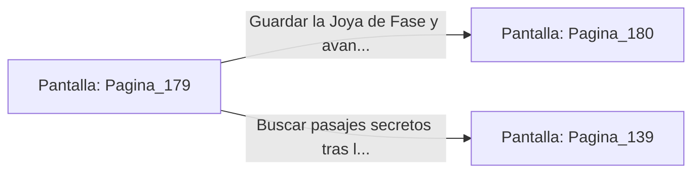

# 📺 Nodo Pantalla: `Pagina_179`

[[Index|⬅️ Índice]] | Fichero Origen: [[sample_eligejuego-code_capitulo_10_mpl|📄 sample/eligejuego-code/capitulo_10.mpl]]

**Narrativa y Encabezado:**
> PÁGINA 179: EL COFRE DE LOS APOSENTOS REALES
> 
> Te inclinas sobre el escritorio de bronce y conectas tu Brazal de Convergencia al cierre rúnico del cofre. La pantalla de tu interfaz decodifica la secuencia de apertura combinando las frecuencias de la antigua dinastía de Aethelgard.
> 
> Con un chasquido metálico, la tapa de bronce se levanta para revelar una Joya de Fase Quántica y una carta escrita por la propia mano de Malakor antes de su corrupción, revelando el código de acceso al Tercer Sello.
> 
> Satisfecho con el hallazgo, guardas la joya y el documento en tu inventario antes de continuar la exploración de los aposentos.

## 📋 Desglose de Instrucciones de Opciones
### `OPCION "Guardar la Joya de Fase y avanzar hacia el Salón de Baile" CON_ACCION TRANSICIONAR_A Pagina_180`
* **Instrucción:** `OPCION` *(Manual: Mapea una entrada o botón interactivo de usuario. Vincular una acción como la invocación de una función C1, un método C2 o una transición C3.)*
* **Efecto de Control:** Dispara `TRANSICIONAR_A` hacia [[Pantalla_Pagina_180|📺 Pagina_180]]
### `OPCION "Buscar pasajes secretos tras las estanterías de la estancia" CON_ACCION TRANSICIONAR_A Pagina_139`
* **Instrucción:** `OPCION` *(Manual: Mapea una entrada o botón interactivo de usuario. Vincular una acción como la invocación de una función C1, un método C2 o una transición C3.)*
* **Efecto de Control:** Dispara `TRANSICIONAR_A` hacia [[Pantalla_Pagina_139|📺 Pagina_139]]

## 📊 Diagrama de Flujo e Interacción (Mermaid)

