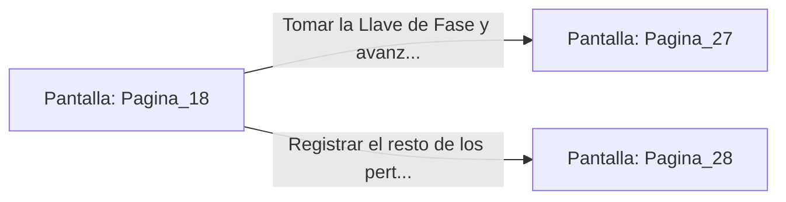

# 📺 Nodo Pantalla: `Pagina_18`

[[Index|⬅️ Índice]] | Fichero Origen: [[sample_eligejuego-code_capitulo_02_mpl|📄 sample/eligejuego-code/capitulo_02.mpl]]

**Narrativa y Encabezado:**
> PÁGINA 18: EL PASAJE DE LA RUNA DE FUEGO
> 
> Asciendes por la rampa seca evitando el agua helada. La pared de piedra está caliente al tacto y las runas talladas en el techo iluminan el camino con un resplandor cobrizo y constante.
> 
> Llegas a una cámara intermedia donde descansan los restos de una expedición fallida. Entre los pertrechos calcinados encuentras una Llave de Fase y una nota que advierte sobre las ilusiones ópticas de la Sala del Abismo.

## 📋 Desglose de Instrucciones de Opciones
### `OPCION "Tomar la Llave de Fase y avanzar hacia la Sala del Abismo" CON_ACCION TRANSICIONAR_A Pagina_27`
* **Instrucción:** `OPCION` *(Manual: Mapea una entrada o botón interactivo de usuario. Vincular una acción como la invocación de una función C1, un método C2 o una transición C3.)*
* **Efecto de Control:** Dispara `TRANSICIONAR_A` hacia [[Pantalla_Pagina_27|📺 Pagina_27]]
### `OPCION "Registrar el resto de los pertrechos en busca de más información" CON_ACCION TRANSICIONAR_A Pagina_28`
* **Instrucción:** `OPCION` *(Manual: Mapea una entrada o botón interactivo de usuario. Vincular una acción como la invocación de una función C1, un método C2 o una transición C3.)*
* **Efecto de Control:** Dispara `TRANSICIONAR_A` hacia [[Pantalla_Pagina_28|📺 Pagina_28]]

## 📊 Diagrama de Flujo e Interacción (Mermaid)

