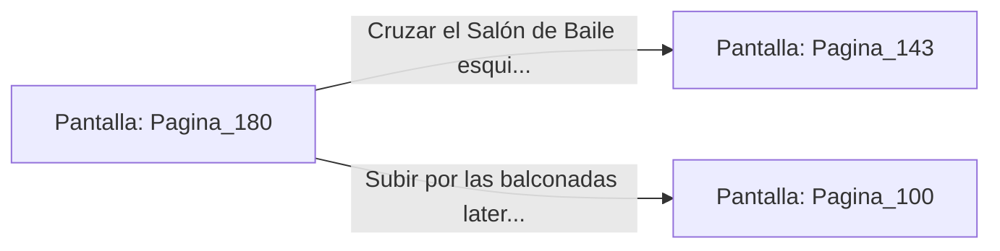

# 📺 Nodo Pantalla: `Pagina_180`

[[Index|⬅️ Índice]] | Fichero Origen: [[sample_eligejuego-code_capitulo_10_mpl|📄 sample/eligejuego-code/capitulo_10.mpl]]

**Narrativa y Encabezado:**
> PÁGINA 180: EL SALÓN DE BAILE
> 
> Entras en el majestuoso Salón de Baile del Palacio. Mármol pulido, lámparas de cristal de éter suspendidas del techo y grandes vidrieras que dan al vacío abisal dominan la inmensa sala.
> 
> En el centro del salón, un grupo de autómatas ceremoniales realiza una danza sin fin al ritmo de una música de orquesta arcana emmitida por gramófonos mágicos.

## 📋 Desglose de Instrucciones de Opciones
### `OPCION "Cruzar el Salón de Baile esquivando a los autómatas ceremoniales" CON_ACCION TRANSICIONAR_A Pagina_143`
* **Instrucción:** `OPCION` *(Manual: Mapea una entrada o botón interactivo de usuario. Vincular una acción como la invocación de una función C1, un método C2 o una transición C3.)*
* **Efecto de Control:** Dispara `TRANSICIONAR_A` hacia [[Pantalla_Pagina_143|📺 Pagina_143]]
### `OPCION "Subir por las balconadas laterales hacia los Aposentos de la Guardia" CON_ACCION TRANSICIONAR_A Pagina_100`
* **Instrucción:** `OPCION` *(Manual: Mapea una entrada o botón interactivo de usuario. Vincular una acción como la invocación de una función C1, un método C2 o una transición C3.)*
* **Efecto de Control:** Dispara `TRANSICIONAR_A` hacia [[Pantalla_Pagina_100|📺 Pagina_100]]

## 📊 Diagrama de Flujo e Interacción (Mermaid)

