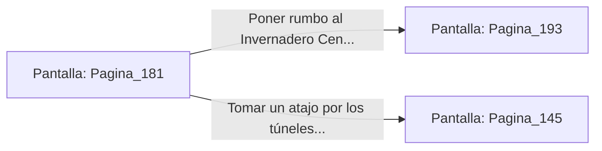

# 📺 Nodo Pantalla: `Pagina_181`

[[Index|⬅️ Índice]] | Fichero Origen: [[sample_eligejuego-code_capitulo_10_mpl|📄 sample/eligejuego-code/capitulo_10.mpl]]

**Narrativa y Encabezado:**
> PÁGINA 181: HUIDA DE LOS ARCHIVOS PRIVADOS
> 
> Te abalanzas sobre el atril central, arrebatas el Código de Anulación del Segundo Sello y echas a correr hacia la salida antes de que los guardianes de piedra completen su secuencia de activación.
> 
> Escuchas el pesado retumbar de los pasos de granito a tus espaldas mientras cruzas las dobles puertas de roble, bloqueando el pasadizo exterior con tu estaca rúnica para impedir la persecución.
> 
> Con el Código de Anulación en tu inventario, pones rumbo definitivo hacia el Invernadero Central de los Jardines Sintéticos.

## 📋 Desglose de Instrucciones de Opciones
### `OPCION "Poner rumbo al Invernadero Central para anular el Segundo Sello" CON_ACCION TRANSICIONAR_A Pagina_193`
* **Instrucción:** `OPCION` *(Manual: Mapea una entrada o botón interactivo de usuario. Vincular una acción como la invocación de una función C1, un método C2 o una transición C3.)*
* **Efecto de Control:** Dispara `TRANSICIONAR_A` hacia [[Pantalla_Pagina_193|📺 Pagina_193]]
### `OPCION "Tomar un atajo por los túneles de evasión" CON_ACCION TRANSICIONAR_A Pagina_145`
* **Instrucción:** `OPCION` *(Manual: Mapea una entrada o botón interactivo de usuario. Vincular una acción como la invocación de una función C1, un método C2 o una transición C3.)*
* **Efecto de Control:** Dispara `TRANSICIONAR_A` hacia [[Pantalla_Pagina_145|📺 Pagina_145]]

## 📊 Diagrama de Flujo e Interacción (Mermaid)

