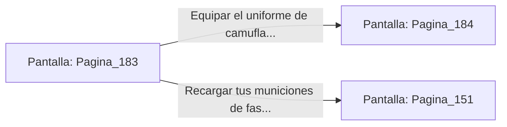

# 📺 Nodo Pantalla: `Pagina_183`

[[Index|⬅️ Índice]] | Fichero Origen: [[sample_eligejuego-code_capitulo_10_mpl|📄 sample/eligejuego-code/capitulo_10.mpl]]

**Narrativa y Encabezado:**
> PÁGINA 183: LA SALA DE ARMAS SECUNDARIA
> 
> Te desvías disimuladamente de la columna de guardia y penetras en la sala de armas secundaria. En el interior reinan el orden y la abundancia: fusiles de pulso, cargas de plasma y cargadores de energía de repuesto reposan en los anaqueles.
> 
> En el centro de la nave encuentras un uniforme de camuflaje térmico completo que anula las lecturas de los sensores ópticos de la guardia de Malakor.
> 
> Tienes la oportunidad de equipar el uniforme de camuflaje térmico o recargar tus municiones de fase antes de proseguir hacia las murallas.

## 📋 Desglose de Instrucciones de Opciones
### `OPCION "Equipar el uniforme de camuflaje térmico para volverte indetectable" CON_ACCION TRANSICIONAR_A Pagina_184`
* **Instrucción:** `OPCION` *(Manual: Mapea una entrada o botón interactivo de usuario. Vincular una acción como la invocación de una función C1, un método C2 o una transición C3.)*
* **Efecto de Control:** Dispara `TRANSICIONAR_A` hacia [[Pantalla_Pagina_184|📺 Pagina_184]]
### `OPCION "Recargar tus municiones de fase e ir a la Armería Central" CON_ACCION TRANSICIONAR_A Pagina_151`
* **Instrucción:** `OPCION` *(Manual: Mapea una entrada o botón interactivo de usuario. Vincular una acción como la invocación de una función C1, un método C2 o una transición C3.)*
* **Efecto de Control:** Dispara `TRANSICIONAR_A` hacia [[Pantalla_Pagina_151|📺 Pagina_151]]

## 📊 Diagrama de Flujo e Interacción (Mermaid)

