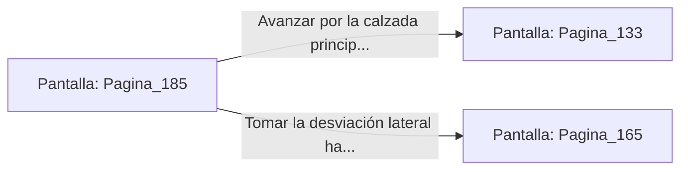

# 📺 Nodo Pantalla: `Pagina_185`

[[Index|⬅️ Índice]] | Fichero Origen: [[sample_eligejuego-code_capitulo_10_mpl|📄 sample/eligejuego-code/capitulo_10.mpl]]

**Narrativa y Encabezado:**
> PÁGINA 185: ELEVADORES DEL NÚCLEO
> 
> Introduces la tarjeta de nivel tres en la ranura del elevador del núcleo. Las compuertas cristalinas se cierran suavemente y la plataforma asciende en silencio propulsada por un campo de levitación magnética.
> 
> A través de las paredes transparentes de la cabina ves pasar los distintos niveles de la fortaleza: los laboratorios, los archivos y las estancias del palacio hasta alcanzar la plataforma superior del Nivel Cero.
> 
> El elevador se detiene abriendo sus puertas frente a la majestuosa calzada que conduce directamente a la Sala del Trono.

## 📋 Desglose de Instrucciones de Opciones
### `OPCION "Avanzar por la calzada principal hacia la Sala del Trono" CON_ACCION TRANSICIONAR_A Pagina_133`
* **Instrucción:** `OPCION` *(Manual: Mapea una entrada o botón interactivo de usuario. Vincular una acción como la invocación de una función C1, un método C2 o una transición C3.)*
* **Efecto de Control:** Dispara `TRANSICIONAR_A` hacia [[Pantalla_Pagina_133|📺 Pagina_133]]
### `OPCION "Tomar la desviación lateral hacia los balcones de la catedral" CON_ACCION TRANSICIONAR_A Pagina_165`
* **Instrucción:** `OPCION` *(Manual: Mapea una entrada o botón interactivo de usuario. Vincular una acción como la invocación de una función C1, un método C2 o una transición C3.)*
* **Efecto de Control:** Dispara `TRANSICIONAR_A` hacia [[Pantalla_Pagina_165|📺 Pagina_165]]

## 📊 Diagrama de Flujo e Interacción (Mermaid)

