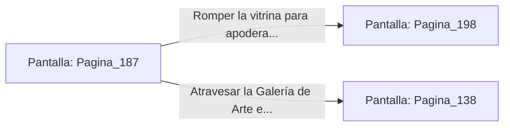

# 📺 Nodo Pantalla: `Pagina_187`

[[Index|⬅️ Índice]] | Fichero Origen: [[sample_eligejuego-code_capitulo_10_mpl|📄 sample/eligejuego-code/capitulo_10.mpl]]

**Narrativa y Encabezado:**
> PÁGINA 187: LA GALERÍA DE ARTE
> 
> Subes por el ramal izquierdo de la escalera y accedes a la sublime Galería de Arte de Aethelgard. Cuadros gigantescos, esculturas de mármol de reyes olvidados y reliquias de la antigua dinastía se alinean en las paredes.
> 
> En una vitrina central protegida por una campana de cristal brilla la Esfera de Convergencia Ancestral, un artefacto capaz de amplificar la potencia del Brazal durante los combates.
> 
> Tienes la opción de romper el cristal de la vitrina para apoderarte de la Esfera o atravesar la galería en silencio rumbo a las dependencias reales.

## 📋 Desglose de Instrucciones de Opciones
### `OPCION "Romper la vitrina para apoderarte de la Esfera de Convergencia" CON_ACCION TRANSICIONAR_A Pagina_198`
* **Instrucción:** `OPCION` *(Manual: Mapea una entrada o botón interactivo de usuario. Vincular una acción como la invocación de una función C1, un método C2 o una transición C3.)*
* **Efecto de Control:** Dispara `TRANSICIONAR_A` hacia [[Pantalla_Pagina_198|📺 Pagina_198]]
### `OPCION "Atravesar la Galería de Arte en silencio hacia los Aposentos Reales" CON_ACCION TRANSICIONAR_A Pagina_138`
* **Instrucción:** `OPCION` *(Manual: Mapea una entrada o botón interactivo de usuario. Vincular una acción como la invocación de una función C1, un método C2 o una transición C3.)*
* **Efecto de Control:** Dispara `TRANSICIONAR_A` hacia [[Pantalla_Pagina_138|📺 Pagina_138]]

## 📊 Diagrama de Flujo e Interacción (Mermaid)

