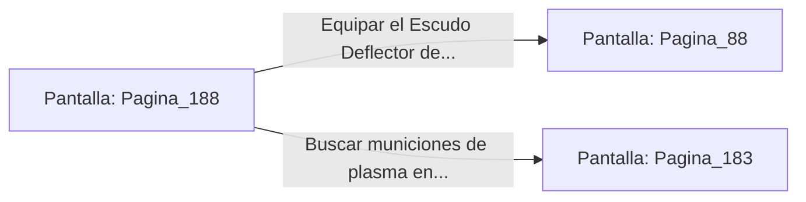

# 📺 Nodo Pantalla: `Pagina_188`

[[Index|⬅️ Índice]] | Fichero Origen: [[sample_eligejuego-code_capitulo_10_mpl|📄 sample/eligejuego-code/capitulo_10.mpl]]

**Narrativa y Encabezado:**
> PÁGINA 188: LA ARMERÍA REAL
> 
> Penetras en la Armería Real del Palacio por el ramal derecho de la escalera. En esta nave se exhiben las armaduras de desfile y las espadas de energía de los antiguos monarcas.
> 
> Sobre un pedestal de piedra encuentras un Escudo Deflector de Fase perfectamente conservado y listo para ser equipado.

## 📋 Desglose de Instrucciones de Opciones
### `OPCION "Equipar el Escudo Deflector de Fase y avanzar hacia el Bastión" CON_ACCION TRANSICIONAR_A Pagina_88`
* **Instrucción:** `OPCION` *(Manual: Mapea una entrada o botón interactivo de usuario. Vincular una acción como la invocación de una función C1, un método C2 o una transición C3.)*
* **Efecto de Control:** Dispara `TRANSICIONAR_A` hacia [[Pantalla_Pagina_88|📺 Pagina_88]]
### `OPCION "Buscar municiones de plasma en las cajas de repuesto" CON_ACCION TRANSICIONAR_A Pagina_183`
* **Instrucción:** `OPCION` *(Manual: Mapea una entrada o botón interactivo de usuario. Vincular una acción como la invocación de una función C1, un método C2 o una transición C3.)*
* **Efecto de Control:** Dispara `TRANSICIONAR_A` hacia [[Pantalla_Pagina_183|📺 Pagina_183]]

## 📊 Diagrama de Flujo e Interacción (Mermaid)

