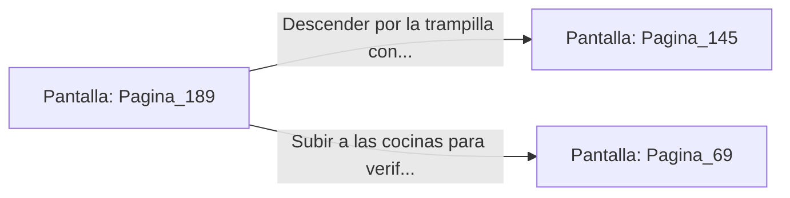

# 📺 Nodo Pantalla: `Pagina_189`

[[Index|⬅️ Índice]] | Fichero Origen: [[sample_eligejuego-code_capitulo_10_mpl|📄 sample/eligejuego-code/capitulo_10.mpl]]

**Narrativa y Encabezado:**
> PÁGINA 189: LOS TONELES DE PROVISIONES
> 
> Examinas los toneles alineados en la despensa subterránea. Al abrir uno de los toneles marcado con la runa de la curación, encuentras tres viales concentrados de Éter Puro intactos.
> 
> Inyectas una de las dosis en tu Brazal para asegurar el nivel máximo de tus reservas de salud y guardas los otros dos viales en tus bolsillos tácticos.
> 
> Con tu equipo médico reabastecido, desciendes por la trampilla secreta para adentrarte en los túneles de evasión.

## 📋 Desglose de Instrucciones de Opciones
### `OPCION "Descender por la trampilla con las medicinas a los túneles de evasión" CON_ACCION TRANSICIONAR_A Pagina_145`
* **Instrucción:** `OPCION` *(Manual: Mapea una entrada o botón interactivo de usuario. Vincular una acción como la invocación de una función C1, un método C2 o una transición C3.)*
* **Efecto de Control:** Dispara `TRANSICIONAR_A` hacia [[Pantalla_Pagina_145|📺 Pagina_145]]
### `OPCION "Subir a las cocinas para verificar la presencia de guardias" CON_ACCION TRANSICIONAR_A Pagina_69`
* **Instrucción:** `OPCION` *(Manual: Mapea una entrada o botón interactivo de usuario. Vincular una acción como la invocación de una función C1, un método C2 o una transición C3.)*
* **Efecto de Control:** Dispara `TRANSICIONAR_A` hacia [[Pantalla_Pagina_69|📺 Pagina_69]]

## 📊 Diagrama de Flujo e Interacción (Mermaid)

