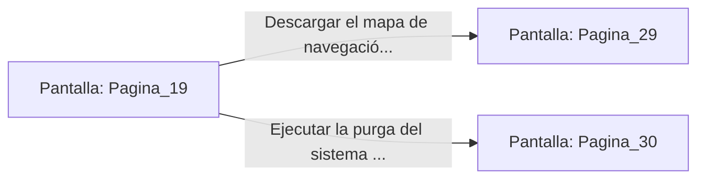

# 📺 Nodo Pantalla: `Pagina_19`

[[Index|⬅️ Índice]] | Fichero Origen: [[sample_eligejuego-code_capitulo_02_mpl|📄 sample/eligejuego-code/capitulo_02.mpl]]

**Narrativa y Encabezado:**
> PÁGINA 19: SIGILO EN LA GALERÍA
> 
> Avanzas agazapado de nicho en nicho, coordinando tus pasos con los zumbidos periódicos de los condensadores de aire. El gigante biomecánico permanece inmóvil frente a la consola, girando lentamente su visor óptico de un lado a otro en un patrón de búsqueda predecible.
> 
> Llegas hasta la base de la consola sin ser detectado. Introduces tu interfaz rúnica en la terminal secundaria; en la pantalla holográfica se despliega el mapa general del sector y el estado operativo del Núcleo de Éter.
> 
> Puedes descargar los datos del mapa para desbloquear rutas seguras o ejecutar un comando de purga para desactivar las defensas del sector.

## 📋 Desglose de Instrucciones de Opciones
### `OPCION "Descargar el mapa de navegación segura del sector" CON_ACCION TRANSICIONAR_A Pagina_29`
* **Instrucción:** `OPCION` *(Manual: Mapea una entrada o botón interactivo de usuario. Vincular una acción como la invocación de una función C1, un método C2 o una transición C3.)*
* **Efecto de Control:** Dispara `TRANSICIONAR_A` hacia [[Pantalla_Pagina_29|📺 Pagina_29]]
### `OPCION "Ejecutar la purga del sistema defensivo" CON_ACCION TRANSICIONAR_A Pagina_30`
* **Instrucción:** `OPCION` *(Manual: Mapea una entrada o botón interactivo de usuario. Vincular una acción como la invocación de una función C1, un método C2 o una transición C3.)*
* **Efecto de Control:** Dispara `TRANSICIONAR_A` hacia [[Pantalla_Pagina_30|📺 Pagina_30]]

## 📊 Diagrama de Flujo e Interacción (Mermaid)

