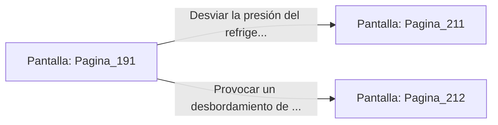

# 📺 Nodo Pantalla: `Pagina_191`

[[Index|⬅️ Índice]] | Fichero Origen: [[sample_eligejuego-code_capitulo_11_mpl|📄 sample/eligejuego-code/capitulo_11.mpl]]

**Narrativa y Encabezado:**
> PÁGINA 191: LA SALA DE BOMBAS
> 
> Te introduces por la escotilla técnica y desciendes por una escala vertical hasta tocar el suelo de la Sala de Bombas del Bastión Central. Enormes tubos de titanio transportan refrigerante de éter a gran presión hacia los sistemas defensivos del recinto.
> 
> En el centro de la nave, una consola de regulación parpadea con indicadores de flujo. Si logras alterar la presión de las bombas, podrías congelar las compuertas de seguridad del sector o desbordar el refrigerante en las galerías de la guardia.
> 
> Debes decidir rápidamente si desviar la presión para congelar las compuertas o desbordar el refrigerante hacia los barracones enemigos.

## 📋 Desglose de Instrucciones de Opciones
### `OPCION "Desviar la presión del refrigerante para congelar las compuertas de seguridad" CON_ACCION TRANSICIONAR_A Pagina_211`
* **Instrucción:** `OPCION` *(Manual: Mapea una entrada o botón interactivo de usuario. Vincular una acción como la invocación de una función C1, un método C2 o una transición C3.)*
* **Efecto de Control:** Dispara `TRANSICIONAR_A` hacia [[Pantalla_Pagina_211|📺 Pagina_211]]
### `OPCION "Provocar un desbordamiento de refrigerante hacia los barracones enemigos" CON_ACCION TRANSICIONAR_A Pagina_212`
* **Instrucción:** `OPCION` *(Manual: Mapea una entrada o botón interactivo de usuario. Vincular una acción como la invocación de una función C1, un método C2 o una transición C3.)*
* **Efecto de Control:** Dispara `TRANSICIONAR_A` hacia [[Pantalla_Pagina_212|📺 Pagina_212]]

## 📊 Diagrama de Flujo e Interacción (Mermaid)

