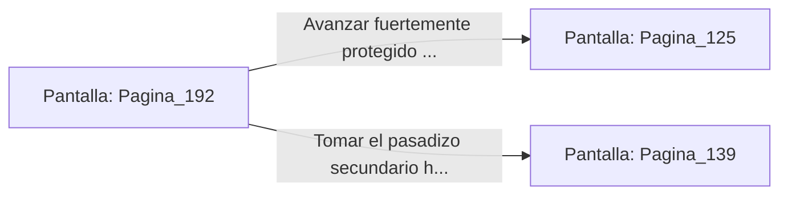

# 📺 Nodo Pantalla: `Pagina_192`

[[Index|⬅️ Índice]] | Fichero Origen: [[sample_eligejuego-code_capitulo_11_mpl|📄 sample/eligejuego-code/capitulo_11.mpl]]

**Narrativa y Encabezado:**
> PÁGINA 192: SOBRECARGA EN LA CELDA DE RECARGA
> 
> Conectas tu Brazal de Convergencia a la celda de recarga rápida de la Armería Central. Una brillante corriente de energía dorada fluye hacia tu dispositivo, restaurando sus escudos refractarios al máximo de su capacidad.
> 
> Con la energía al límite y los indicadores en verde, te dispones a abandonar la armería antes de que las patrullas del patio bloqueen la salida.

## 📋 Desglose de Instrucciones de Opciones
### `OPCION "Avanzar fuertemente protegido hacia el Patio Central" CON_ACCION TRANSICIONAR_A Pagina_125`
* **Instrucción:** `OPCION` *(Manual: Mapea una entrada o botón interactivo de usuario. Vincular una acción como la invocación de una función C1, un método C2 o una transición C3.)*
* **Efecto de Control:** Dispara `TRANSICIONAR_A` hacia [[Pantalla_Pagina_125|📺 Pagina_125]]
### `OPCION "Tomar el pasadizo secundario hacia los Archivos Privados" CON_ACCION TRANSICIONAR_A Pagina_139`
* **Instrucción:** `OPCION` *(Manual: Mapea una entrada o botón interactivo de usuario. Vincular una acción como la invocación de una función C1, un método C2 o una transición C3.)*
* **Efecto de Control:** Dispara `TRANSICIONAR_A` hacia [[Pantalla_Pagina_139|📺 Pagina_139]]

## 📊 Diagrama de Flujo e Interacción (Mermaid)

