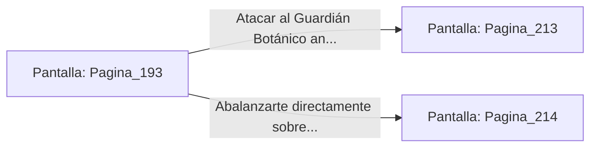

# 📺 Nodo Pantalla: `Pagina_193`

[[Index|⬅️ Índice]] | Fichero Origen: [[sample_eligejuego-code_capitulo_11_mpl|📄 sample/eligejuego-code/capitulo_11.mpl]]

**Narrativa y Encabezado:**
> PÁGINA 193: EL INVERNADERO CENTRAL
> 
> Llegas a la monumental cúpula acristalada del Invernadero Central, el corazón de los Jardines Sintéticos. En el centro del recinto, flotando sobre un estanque de límpida savia bioluminiscente, brilla el Segundo Sello de Fase protegido por un domo de inducción energética.
> 
> Usas los códigos de anulación obtenidos para debilitar la barrera. El domo chispotea y se disipa paulatinamente, dejando al descubierto la reliquia sin la protección de sus escudos primarios.
> 
> Sin embargo, la desactivación del campo de fuerza activa un Guardián Botánico biomecánico que emerge del fondo del estanque emitiendo un agudo rugido metálico.

## 📋 Desglose de Instrucciones de Opciones
### `OPCION "Atacar al Guardián Botánico antes de apoderarte del sello" CON_ACCION TRANSICIONAR_A Pagina_213`
* **Instrucción:** `OPCION` *(Manual: Mapea una entrada o botón interactivo de usuario. Vincular una acción como la invocación de una función C1, un método C2 o una transición C3.)*
* **Efecto de Control:** Dispara `TRANSICIONAR_A` hacia [[Pantalla_Pagina_213|📺 Pagina_213]]
### `OPCION "Abalanzarte directamente sobre el estanque para tomar el Segundo Sello" CON_ACCION TRANSICIONAR_A Pagina_214`
* **Instrucción:** `OPCION` *(Manual: Mapea una entrada o botón interactivo de usuario. Vincular una acción como la invocación de una función C1, un método C2 o una transición C3.)*
* **Efecto de Control:** Dispara `TRANSICIONAR_A` hacia [[Pantalla_Pagina_214|📺 Pagina_214]]

## 📊 Diagrama de Flujo e Interacción (Mermaid)

