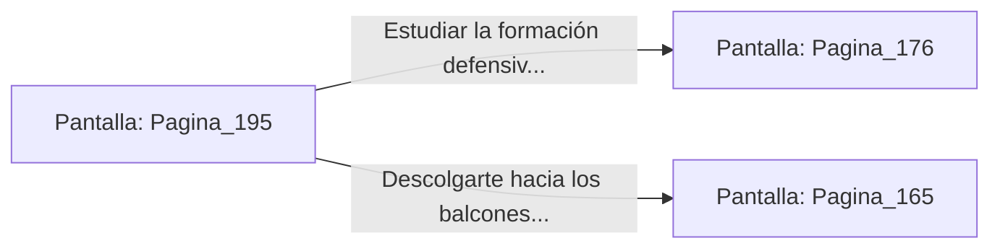

# 📺 Nodo Pantalla: `Pagina_195`

[[Index|⬅️ Índice]] | Fichero Origen: [[sample_eligejuego-code_capitulo_11_mpl|📄 sample/eligejuego-code/capitulo_11.mpl]]

**Narrativa y Encabezado:**
> PÁGINA 195: EL PASAJE TRAS EL CUADRO
> 
> Presionas el resorte oculto en el marco de oro y el gran cuadro de la caída de Aethelgard se desliza a un lado, revelando un angosto pasadizo iluminado por cristales arcanos.
> 
> Avanzas por el pasaje secreto escuchando el distante sonido de los sistemas hidráulicos de la ciudadela. Tras unos minutos de marcha, el túnel desemboca en un mirador encubierto que da directamente a la Sala del Trono.
> 
> Desde esta posición privilegiada, puedes inspeccionar las defensas personales de Malakor o descolgarte con cautela hacia los balcones laterales.

## 📋 Desglose de Instrucciones de Opciones
### `OPCION "Estudiar la formación defensiva de Malakor desde el mirador" CON_ACCION TRANSICIONAR_A Pagina_176`
* **Instrucción:** `OPCION` *(Manual: Mapea una entrada o botón interactivo de usuario. Vincular una acción como la invocación de una función C1, un método C2 o una transición C3.)*
* **Efecto de Control:** Dispara `TRANSICIONAR_A` hacia [[Pantalla_Pagina_176|📺 Pagina_176]]
### `OPCION "Descolgarte hacia los balcones laterales de la Sala del Trono" CON_ACCION TRANSICIONAR_A Pagina_165`
* **Instrucción:** `OPCION` *(Manual: Mapea una entrada o botón interactivo de usuario. Vincular una acción como la invocación de una función C1, un método C2 o una transición C3.)*
* **Efecto de Control:** Dispara `TRANSICIONAR_A` hacia [[Pantalla_Pagina_165|📺 Pagina_165]]

## 📊 Diagrama de Flujo e Interacción (Mermaid)

