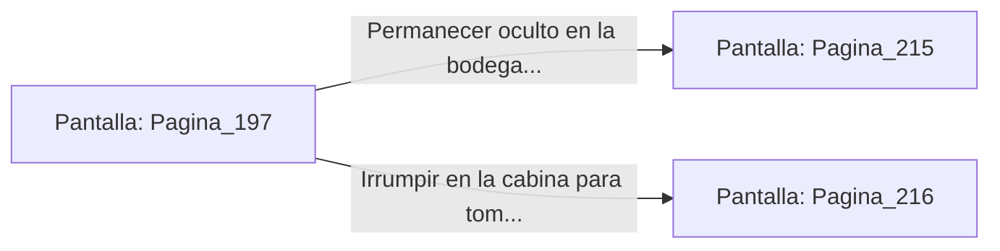

# 📺 Nodo Pantalla: `Pagina_197`

[[Index|⬅️ Índice]] | Fichero Origen: [[sample_eligejuego-code_capitulo_11_mpl|📄 sample/eligejuego-code/capitulo_11.mpl]]

**Narrativa y Encabezado:**
> PÁGINA 197: INFILTRACIÓN EN LA LANZADERA
> 
> Te deslizas bajo la rampa de carga de la lanzadera de asalto mientras los mecánicos trabajan distraídos en el motor del flanco opuesto. Te oculta entre los cajones de pertrechos de la bodega de carga.
> 
> Un momento después, los motores de la nave se encienden con un sordo rugido y la plataforma de elevación transporta la lanzadera hacia la pista de despegue exterior.
> 
> La nave despega rumbo a la Torre del Trono. Puedes permanecer escondido hasta el aterrizaje o intentar tomar el control de la cabina de pilotaje en pleno vuelo.

## 📋 Desglose de Instrucciones de Opciones
### `OPCION "Permanecer oculto en la bodega hasta el aterrizaje en la Torre del Trono" CON_ACCION TRANSICIONAR_A Pagina_215`
* **Instrucción:** `OPCION` *(Manual: Mapea una entrada o botón interactivo de usuario. Vincular una acción como la invocación de una función C1, un método C2 o una transición C3.)*
* **Efecto de Control:** Dispara `TRANSICIONAR_A` hacia [[Pantalla_Pagina_215|📺 Pagina_215]]
### `OPCION "Irrumpir en la cabina para tomar el control de la lanzadera" CON_ACCION TRANSICIONAR_A Pagina_216`
* **Instrucción:** `OPCION` *(Manual: Mapea una entrada o botón interactivo de usuario. Vincular una acción como la invocación de una función C1, un método C2 o una transición C3.)*
* **Efecto de Control:** Dispara `TRANSICIONAR_A` hacia [[Pantalla_Pagina_216|📺 Pagina_216]]

## 📊 Diagrama de Flujo e Interacción (Mermaid)

